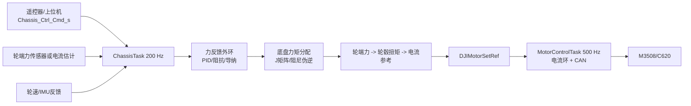

# 力控底盘方案（基于当前框架）

## 结论

可以做，但需要区分两种目标：

1. **电流/力矩控制**：当前框架已经具备基础条件。`DJIMotorInstance` 能读取 M3508 的 `measure.real_current`，`DJIMotorControl()` 也支持 `CURRENT_LOOP`。这条路线不需要新增传感器，但得到的是“由电机电流估算的轮端力矩”，不能称为严格的接触力闭环。
2. **真正的底盘力控**：软件链路已经补齐为“传感器话题 → 力反馈外环 → 轮端力分配 → 电流环”，但必须接入真实轮端力传感器并完成标定后，才可以称为实车闭环力控。没有传感器时，`CHASSIS_CONTROL_TORQUE` 仍只是电流估算力矩模式。

建议先实现“轮端电流/力矩模式”，确认方向、单位、限流和安全链路，再接入力传感器实现力跟踪或导纳控制。

## 初始版实现状态

当前已在 `application/chassis/chassis.c` 落地一版可回退的电流/估算力矩路径：

- M3508 初始化同时启用速度环和电流环，默认外环仍为速度环；
- `CHASSIS_CONTROL_TORQUE` 使用四轮雅可比阻尼伪逆，将 `fx_ref/fy_ref/mz_ref` 分配到四个轮端；
- 按轮半径、减速比、传动效率和电机转矩常数换算 DJI CAN 原始电流，加入单轮限流和参考斜坡；
- A 板底盘初始化会复用 MPU6500/INS 的 `Gyro[2]`，对估算力矩的 `Mz` 增加有限幅旋转阻尼；
- 速度模式与电流模式切换时清空 PID 状态；
- `CHASSIS_CONTROL_FORCE_TRACK` 使用 `chassis_force_sensor` 话题的轮端传感器数据运行力误差 PID；传感器协议错误、序号重复或超过 100 ms 未更新时立即停机。
- `CHASSIS_CONTROL_ADMITTANCE` 使用同一传感器反馈运行质量-阻尼导纳，并限制最大速度；没有有效传感器时立即停机。

启用方式是发送 `Chassis_Ctrl_Cmd_s.control_mode = CHASSIS_CONTROL_TORQUE`，并填写 `fx_ref/fy_ref/mz_ref`；`chassis_mode = CHASSIS_ZERO_FORCE` 仍具有最高急停优先级。遥控器默认持续发送速度模式，不会意外进入力控。

这版代码的标定常量位于 `chassis.c` 顶部（`FORCE_*`），仅用于上电前的台架调试，不能直接视为实车最终参数。

## 当前框架的能力和缺口

### 已有能力

- `modules/motor/dji/dji_motor.c` 已解析编码器、转速、电机实际电流和温度。
- 电机控制环支持 `CURRENT_LOOP | SPEED_LOOP | ANGLE_LOOP`，可以通过 `DJIMotorOuterLoop()` 运行时切换外环。
- `DJIMotorSetRef()` 可写入电机参考值，CAN 发送由 `MotorControlTask()` 统一完成。
- 底盘应用已有四轮全向轮运动学解算，可作为力/力矩分配的轮速矩阵基础。
- 单板消息中心和双板 `CANComm` 都可传递新的力控命令和反馈。

### 必须补齐的缺口

- 当前底盘初始化只配置了 `speed_PID`，没有配置电流环参数；不能直接切换到电流环。
- 当前 `DJI_Motor_Measure_s.real_current` 是 CAN 原始量（`int16_t`）。虽然旧版 `dji_motor.md` 写成了安培，但现行控制代码没有做安培换算，力控实现应以代码实际单位为准，并统一标定。
- `EstimateSpeed()` 尚未实现，力控中的速度阻尼、打滑检测和导纳控制无法直接使用。
- 工程中 `dji_motor.c` 和 `power_control.c` 各自维护一套电机注册数组。底盘用的是 `DJIMotorInit()`，而 `SetPowerLimit()` 只修改 `power_control.c` 的变量，因此当前底盘的功率限制链路实际上没有接到 `DJIMotorControl()`。力控上线前必须修正这一点。
- 没有力传感器驱动、零点校准、传感器掉线和异常值处理。

## 推荐控制架构



正常速度模式仍保留原来的“底盘速度 → 轮速 → 速度环”。只有进入力控模式时，才使用“底盘期望力/力矩 → 轮端力 → 电机电流”。急停始终优先于任何力控命令。

## 数据结构修改

在 `application/robot_msg.h` 中扩展模式和命令。由于单板和双板都传输 `sizeof(Chassis_Ctrl_Cmd_s)`，两端必须同时编译更新；结构体继续保持 `#pragma pack(1)`，总长度须小于 `CAN_COMM_MAX_BUFFSIZE`（当前为 60 字节）。例如：

```c
typedef enum
{
    CHASSIS_ZERO_FORCE = 0,
    CHASSIS_ROTATE,
    CHASSIS_NO_FOLLOW,
    CHASSIS_FOLLOW_GIMBAL_YAW,
    CHASSIS_FORCE_TORQUE,   // 期望底盘合力/合力矩
    CHASSIS_FORCE_TRACK,    // 带传感器的力跟踪
    CHASSIS_ADMITTANCE,     // 力误差转换为速度修正
} chassis_mode_e;

typedef struct
{
    float vx, vy, wz;       // 速度模式命令
    float offset_angle;
    chassis_mode_e chassis_mode;
    int chassis_speed_buff;

    float fx_ref;           // N，底盘坐标系 +x
    float fy_ref;           // N，底盘坐标系 +y
    float mz_ref;           // N·m，绕 z 轴
} Chassis_Ctrl_Cmd_s;
```

建议在 `Chassis_Upload_Data_s` 增加 `force_valid`、`wheel_force[4]`、`fx/fy/mz`、`current_ref[4]` 等调试字段；若不想改变原有通信协议，也可以新增独立的 `chassis_force_feed` 话题。

当前实现已经采用独立话题：底盘发布 `chassis_force_feed`，力传感器驱动发布 `chassis_force_sensor`。传感器发布的数据必须将 `protocol_version` 设为 `CHASSIS_FORCE_FEED_VERSION`，`force_source` 设为 `CHASSIS_FORCE_SOURCE_SENSOR`，并让 `sample_seq` 每帧递增。`FORCE_TRACK` 和 `ADMITTANCE` 只接受该来源的有效数据；`CHASSIS_CONTROL_TORQUE` 不依赖传感器，仍使用电机电流估算轮端力。

## 电机层改动

### 1. 配置电流环

在 `ChassisInit()` 的 `Motor_Init_Config_s` 中增加电流 PID，并保留速度 PID 以便运行时回退：

```c
.controller_param_init_config = {
    .current_PID = {
        .Kp = CURRENT_KP,
        .Ki = CURRENT_KI,
        .Kd = 0.0f,
        .IntegralLimit = CURRENT_I_LIMIT,
        .MaxOut = CURRENT_CMD_LIMIT, // M3508 原始电流命令，通常不超过 16384
        .Improve = PID_Integral_Limit | PID_OutputFilter,
        .Output_LPF_RC = 0.002f,
    },
    .speed_PID = { /* 原有参数 */ },
},
.controller_setting_init_config = {
    .outer_loop_type = SPEED_LOOP,       // 默认仍为速度模式
    .close_loop_type = SPEED_LOOP | CURRENT_LOOP,
    .angle_feedback_source = MOTOR_FEED,
    .speed_feedback_source = MOTOR_FEED,
},
```

进入力矩模式时：

```c
DJIMotorOuterLoop(motor_lf, CURRENT_LOOP);
DJIMotorSetRef(motor_lf, current_ref_lf_raw);
```

四个轮子都要执行同样的切换。退出力控时切回 `SPEED_LOOP`，并重新写入速度参考值。

### 2. 明确电流单位

现行 `DJIMotorControl()` 对电流环执行：

```c
pid_ref = PIDCalculate(&motor->motor_controller.current_PID,
                       motor->measure.real_current, pid_ref);
```

因此 `current_PID` 的反馈和 `DJIMotorSetRef()` 的电流目标必须使用同一单位。推荐第一版统一使用 DJI CAN 原始量：M3508 约为 `-16384..16384`，并将“原始量/安培”的换算系数作为配置常量，而不是在不同模块中混用。

## 底盘力矩分配

不要直接复用当前 `LF_CENTER` 等宏作为物理力臂；它们包含 `DEGREE_2_RAD`，是当前轮速标定关系的一部分。力控应使用真实几何尺寸（建议统一为米）。

### 1. 建立轮子雅可比矩阵

对第 `i` 个轮子，设轮子驱动方向单位向量为 `t_i=(cosθ_i,sinθ_i)`，轮子相对底盘中心的位置为 `p_i=(x_i,y_i)`，则：

```text
J_i = [ t_ix, t_iy, p_ix*t_iy - p_iy*t_ix ]
v_wheel_i = J_i · [vx, vy, wz]
```

X 型全向轮可按当前代码的顺序使用：RF=45°、LF=135°、LB=225°、RB=315°。轮子安装方向若与此不同，只修改 `θ_i` 或增加方向符号，不要在多个地方散落修改正负号。

注意：当前工程的 `OmniCalculate()` 已固定了四个电机对 `vx/vy/wz` 的符号，初始实现直接复用其平动列，并使用 `(half wheelbase + half track width)·cos45°` 作为旋转有效力臂。不要把轮位坐标和上述角度机械地按另一套左右坐标系混用；最终正负号须以悬空逐轮测试为准。

### 2. 由底盘期望力/力矩求轮端力

底盘合力/合力矩满足：

```text
W = [Fx, Fy, Mz]ᵀ = Jᵀ · f
```

推荐使用阻尼最小二乘伪逆，避免轮子受力不一致或矩阵接近奇异时出现尖峰：

```text
f = J · (JᵀJ + λI)^(-1) · W
```

其中 `f=[f_rf,f_lf,f_lb,f_rb]ᵀ`，`λ` 取很小的正数（例如 `1e-4`，需按单位和数值范围实测）。对于几何完全对称的 X 型四轮，也可以预先推导闭式矩阵，但建议先写通用矩阵版本，便于后续修改轮距和轮子角度。

### 3. 轮端力转换为电机电流

```text
tau_wheel_i = f_i * R_wheel
tau_motor_i = tau_wheel_i / (gear_ratio * efficiency)
current_ref_raw_i = tau_motor_i / Kt * CURRENT_RAW_PER_A
```

`Kt`、减速比、传动效率必须通过实测标定。工程中 `power_control.c` 的 `TORQUE_COEF` 可作为初始参考，但不要直接假设它就是轮端输出轴的精确系数。最后对每个电机做电流限幅、变化率限幅，并在功率超限时按同一比例缩放四个轮子的参考值。

## 力反馈外环

### 方案 A：无力传感器（力矩/电流模式）

使用 `real_current` 估算电机转矩，再经减速比和轮半径得到轮端驱动力。该模式适合做：

- 低速推力控制；
- 轮子输出扭矩一致性控制；
- 起步/停止时的加速度和电流限制。

它不能可靠测量地面接触力，因为会受到摩擦、减速箱效率、轮胎打滑和电机温升影响。文档、遥控器界面和日志中应明确标记为“估算力矩”。

### 方案 B：轮端力传感器（推荐的严格力控）

新增 `modules/force_sensor/force_sensor.[ch]`，至少提供：

```c
bool ForceSensorRead(float wheel_force[4]);
bool ForceSensorIsOnline(void);
void ForceSensorCalibrateZero(void);
```

ADC/应变放大器或 CAN 传感器数据依次执行零点扣除、比例换算、限幅和一阶低通。启动时在轮子无载状态采集零点；运行时使用计数器或 `Daemon` 监视超时。得到 `f_meas` 后计算 `W_meas = Jᵀ f_meas`，再对 `Fx/Fy/Mz` 分别运行 PID：

```c
force_out_x = PIDCalculate(&force_pid_x, W_meas.fx, cmd.fx_ref);
force_out_y = PIDCalculate(&force_pid_y, W_meas.fy, cmd.fy_ref);
force_out_z = PIDCalculate(&force_pid_z, W_meas.mz, cmd.mz_ref);
W_cmd = W_feedforward + [force_out_x, force_out_y, force_out_z];
```

传感器无效、超量程或通信超时必须立即退出力跟踪，进入零电流或受限速度模式，不能继续使用最后一次有效力值。

### 方案 C：导纳/阻抗控制

若目标是“碰到墙后保持一定推力，同时允许底盘让步”，不要只做力 PID，可增加导纳环：

```text
M * dv/dt + D * v + K * x = W_ref - W_meas
v_cmd = v_user + v_force
```

计算出的 `v_cmd` 再走现有轮速运动学和速度环。导纳参数 `M/D/K` 需要从较大阻尼、较小增益开始调试；必须设置最大速度、最大位移积分和接触丢失保护。

## `ChassisTask()` 建议改造顺序

保留原有速度模式流程，在模式分支中增加力控路径：

```c
void ChassisTask(void)
{
    ReadChassisCommand(&chassis_cmd_recv);
    UpdateSafetyAndPowerLimit();

    if (chassis_cmd_recv.chassis_mode == CHASSIS_ZERO_FORCE) {
        StopAllChassisMotors();
        ResetForceControllers();
        return;
    }

    ReadForceSensorsOrEstimate(&force_feedback);

    if (chassis_cmd_recv.chassis_mode == CHASSIS_FORCE_TRACK) {
        W_cmd = ForceOuterLoop(chassis_cmd_recv, force_feedback);
        WheelForceToCurrent(W_cmd, current_ref_raw);
        LimitCurrentAndPower(current_ref_raw);
        SetFourMotorCurrentRef(current_ref_raw);
    } else if (chassis_cmd_recv.chassis_mode == CHASSIS_ADMITTANCE) {
        v_cmd = AdmittanceUpdate(chassis_cmd_recv, force_feedback);
        ChassisVelocityToWheelSpeed(v_cmd, wheel_speed_ref);
        SetFourMotorSpeedRef(wheel_speed_ref);
    } else {
        RunExistingVelocityControl();
    }

    EstimateSpeed();
    PublishChassisFeedback();
}
```

`ChassisTask()` 当前由 `RobotTask()` 以 200 Hz 运行，`MotorControlTask()` 以 500 Hz 运行。建议力传感器采样至少 500 Hz，外环 200 Hz，电流内环 500 Hz；所有 PID 的 `dt` 使用实际 DWT 时间，不要写死成固定值。

## 功率限制和双板注意事项

力控很容易在低速堵转时持续拉大电流，必须先修复功率限制：

1. 要么把底盘电机全部改为同一套 `PowerControlInit()/PowerControl()` 路径；
2. 要么将功率限制逻辑合并到 `DJIMotorControl()`，让 `SetPowerLimit()` 写入同一份全局状态；
3. 不要继续让 `DJIMotorInit()` 和 `PowerControlInit()` 各自注册同一批电机，否则一套控制器会收不到这些电机。

双板模式下，`Chassis_Ctrl_Cmd_s` 的大小变化必须同时更新云台板和底盘板的 `CANComm_Init_Config_s.recv_data_len/send_data_len`。新增字段应放在结构体尾部，并在协议版本不一致时拒绝进入力控模式。

## 安全策略

- 遥控器、板间 CAN、力传感器、电机反馈任一关键链路离线：`DJIMotorStop()`，不要只把参考值设为 0。
- 当前/估算力矩超过阈值持续一定时间：降额或退出力控；传感器超量程立即退出。
- 力控参考值设置斜坡，限制每周期最大变化量；四轮电流同步缩放，避免单轮先饱和导致横摆。
- 进入力控时清空 PID 积分，退出力控时恢复速度环并重新设置当前速度参考，避免模式切换跳变。
- 记录 `W_ref/W_meas`、四轮力、四轮电流参考/反馈、功率和传感器状态，优先使用现有 RTT/JScope 通道。

## 标定与调试步骤

1. 仅保留一个轮子，关闭力反馈外环，确认电流正负号与轮子正方向一致。
2. 标定 `CURRENT_RAW_PER_A`、`Kt`、减速比和传动效率；比较四个轮子的空载电流。
3. 接入力传感器，静止采集零点，逐个轮子施加已知载荷，拟合比例和线性误差。
4. 用很小的 `Kp`、`Ki=0` 做单轴力阶跃，确认无振荡和无持续积分饱和。
5. 逐步增加 `Ki`，再加入速度阻尼/导纳；最后测试四轮合力、纯横移和纯旋转。
6. 在悬空、地面低摩擦、单轮离地、传感器断线、CAN 断线和急停条件下验证降级行为。

## 验收标准

- 力控模式下四个电机均实际运行 `CURRENT_LOOP`，参考单位和反馈单位一致。
- 传感器有效时，`Fx/Fy/Mz` 稳态误差、超调和响应时间达到项目指标；无传感器时明确标注为估算力矩模式。
- 电流、温度、功率、CAN 在线状态和传感器状态全部有上限与故障处理。
- 速度模式、力控模式、导纳模式可以安全切换，急停优先级不变。
- 单板消息中心和双板 CAN 的结构体大小、字段顺序、协议版本一致。

## 相关源码位置

- `application/chassis/chassis.c`：底盘初始化、运动学和任务流程
- `application/chassis/chassis.h`：底盘应用接口
- `application/robot_msg.h`：底盘模式及单板/双板通信结构体
- `modules/motor/dji/dji_motor.c`、`dji_motor.h`：电机反馈、电流/速度/位置闭环和 CAN 发送
- `modules/motor/motor_def.h`：闭环类型、反馈来源和控制器配置
- `modules/motor/power_control.c`、`power_control.h`：现有功率模型（需与 DJI 电机注册路径统一）
- `Core/Src/freertos.c`：当前电机任务 500 Hz、机器人任务 200 Hz 的调度位置
