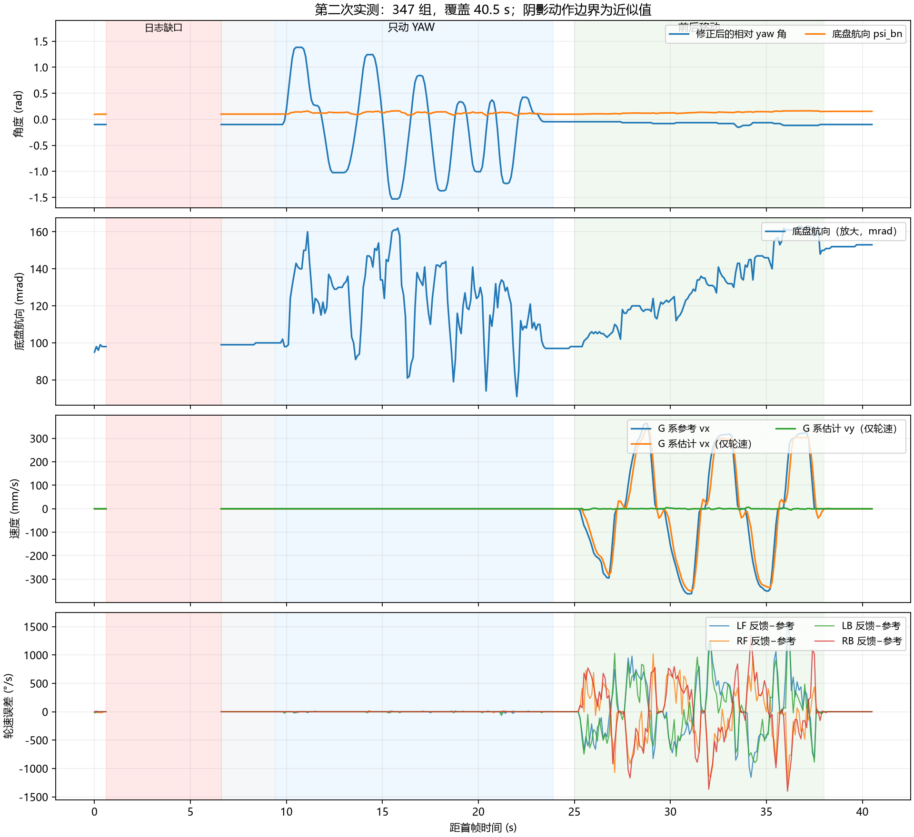

# 2026-10-25 第二次运动日志：YAW 符号复测与前后移动

来源：用户提供的第二次通道 0 文本，seq 20～8120，共 347 组完整四行数据，首末跨度 40.499992 s。动作阶段根据轮速和角速度近似划分，以下时间相对首帧。

全部文本字段已整理为 [CSV 数据](20261025_第二次运动日志数据.csv)，可用 Excel 查看。数组后缀 0～3 的四轮顺序仍为 LF/RF/LB/RB。

## 结论

本次实车日志支持之前的 YAW 编码器符号修正：云台大幅转动时，计算的底盘航向不再出现数弧度的假转动。底盘前后移动时，四轮持续有反馈，未再观察到上一段参考约 2000°/s 而 LB 反馈接近零的现象。但这只是本次工况下没有复现，不能据此排除低速/低负载边界问题。

本次没有修改控制代码、PID 参数或融合放行开关。当前仍是仅轮速估计诊断，保持 MC_ESTIMATE_ONLY、MC_IMU_ACCEL_VALIDATED=0。

## 日志完整性与采样

- mode 始终 1，valid=0，exit=5，accel=0，wheel_mask=15，obs=5。与当前配置相符；只使用轮速 vx/vy 量测，IMU 加速度没有参与融合。
- 控制周期 4.969～5.014 ms，IMU 年龄 733～784 μs，命令年龄 23～46 μs，已输出样本的时效正常。
- qdrop=0。tdrop 在首 7 组为 0，之后为 59，随后不再增加。
- seq 从 140 直接跳到 1340，对应约 0.6～6.6 s 之间缺少 59 组，恰与 tdrop 增量一致。说明这段存在 RTT 发送丢组，不能把缺口当成连续观测；具体原因需要结合当时是否暂停读取/调试等情况判断，不能断言 MCU 控制停了 6 秒。
- 未出现非有限值的整数标记，限幅和电流饱和标志始终为 0。
- 最初约 0～0.6 s 的 IMU y 轴角速度绝对值达到 3.545 rad/s，不能把开头这几组作为稳定静止标定；日志缺口后的静止段更适合作为本次基准。

## 只动 YAW：约 9.4～23.9 s

| 项目 | 统计 |
| --- | --- |
| 相对 yaw 角 theta | -1.531～1.383 rad，跨度约 167° |
| 计算底盘航向 psi_bn | 0.071～0.162 rad，跨度约 5.2° |
| psi_bn 标准差 | 约 0.0201 rad，即 1.15° |
| 动作前静止底盘航向均值 | 约 0.0994 rad |
| 动作后静止底盘航向均值 | 约 0.0973 rad，前后差约 -0.12° |
| G 系估计平移速度 | 打印精度下始终为零 |

这说明符号修正有效。psi_bn 的绝对值不要求为零，约 0.1 rad 的起始值本身不是故障。快速转动期间仍有动态波动，可能涉及测量时序、角度反馈滤波、安装和姿态误差，当前不能归因于某一个因素。动作前后基本回到同一值，优于将动态峰峰值误认为持续漂移。

不能将零平移估计解读为加速度已经正确：加速度融合仍关闭。该段候选水平加速度 ax 为 -1.077～0.870 m/s²，ay 为 -1.374～0.823 m/s²；RMS 约 (0.331,0.357) m/s²。这可能含安装点真实旋转加速度和估计误差，需要参考点校正及动态验证。

## 前后移动：约 25～38 s

参考 vy 始终为零，较适合检查横向串扰。参考 vx 范围为 ±0.363 m/s，估计 vx 为 -0.350～0.346 m/s。估计 vy 为 -0.005～0.006 m/s，RMS 约 0.00168 m/s；相比上一次日志的较大横向估计，本次现象明显减轻，但两次速度与动作过程不同，不能当作严格 A/B 性能验收。

整段 vx 误差 RMS 约 0.0460 m/s，最大绝对值约 0.123 m/s，含起步、停车和换向的动态误差，不能用整段 RMS 直接评价稳态 PID。

粗略筛选准稳态：过去约 0.5 s 至少 5 个样本，参考 vx 幅值不小于 0.2 m/s，期间变化不大于 0.015 m/s。只有 8 个样本符合，vx 误差 RMS 约 0.0165 m/s，样本较少，只能作初步参考。

| 准稳态 seq | 参考 vx (m/s) | 估计 vx (m/s) |
| --- | --- | --- |
| 6240 | -0.362 | -0.350 |
| 6640 | 0.318 | 0.298 |
| 7060 | -0.342 | -0.337 |
| 7440 | 0.324 | 0.304 |

上述准稳态样本中四轮反馈/参考幅值的平均比值分别约为 LF 0.924、RF 0.943、LB 0.944、RB 0.959，存在几百分点的整体跟踪不足，但小样本不足以据此直接决定 PID 改动。

整段移动中，四轮均未出现“|参考|≥1500°/s 同时 |反馈|<100°/s”的已采样情况。原 LB 近停转现象在本次没有复现，当前不针对 LB 单独改参数。

速度是轮速逆解与滤波结果，并非外部实测车速。轮径比例、实际前后方向、打滑和地面横向偏移还需要外部距离/轨迹验证。

## 下一步

1. 保持当前估计模式，停止反复快速换向，做每方向持续 3～5 s 的固定低速前进/后退，中间停车 2 s。优先获得长于瞬态的四轮跟踪数据；条件允许时同步测量时间和实际距离，核对轮速估计尺度。
2. 暂不启用加速度融合或主动补偿。需要确认 IMU 是否随 pitch 转动，并测量 IMU 相对 pitch 轴的位置，以及 pitch 轴相对 yaw 轴的位置；仅有平面 yaw 偏置模型不能覆盖任意 pitch 杆臂运动。
3. 补充安装位置后，再安排固定底盘的慢速 yaw/pitch、快速 yaw/pitch 动态校正检查，区分安装点真实加速度和姿态/滤波误差。
4. 采集时让通道 0 读取工具持续运行，避免采集中断读数；tdrop 不再增长才说明后续段没有新增传输丢组。日志缺口无需通过增大 PID 或打开融合来处理。
