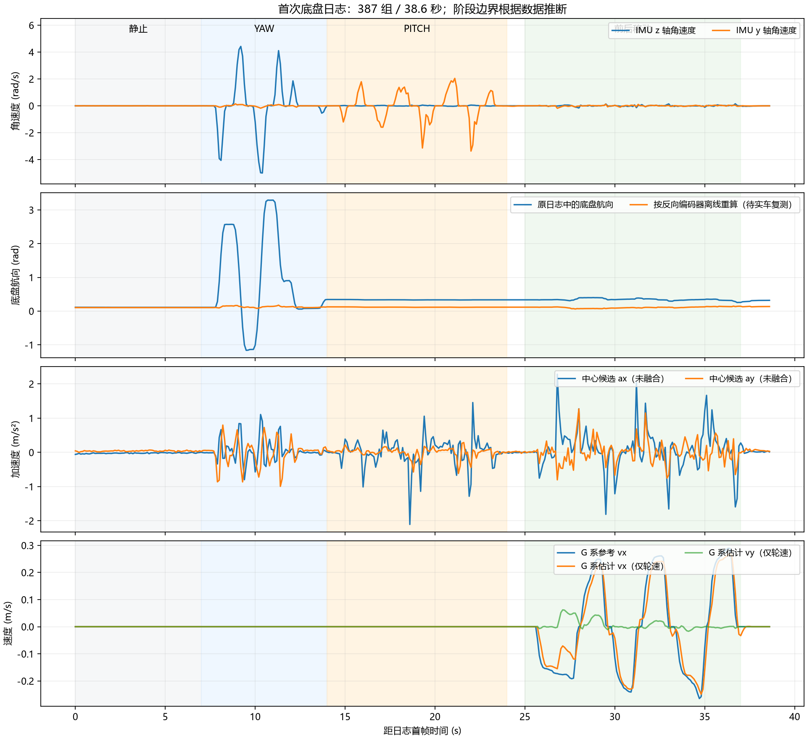

# 2026-10-25 首次运动日志分析

来源：用户提供的通道 0 文本，seq 10020～17740，共 387 组完整四行日志，跨度 38.600011 s。以下时间相对日志首帧，动作分段按角速度和轮速推断，边界为近似值。

## 采样与模式

- 四轮在线掩码始终 15，观测掩码始终 5，仅融合 vx/vy。
- 控制周期 4.970～5.031 ms；IMU 年龄 730～790 μs，命令年龄 23～63 μs。
- qdrop 始终 0；tdrop 始终 77。本段没有新增传输丢组，77 是首帧之前的累计值，不能据此断定此前丢组的原因。
- 始终 mode=1、valid=0、exit=5、accel=0，符合未放行 IMU 加速度融合的当前配置；不表示加速度标定已经通过。
- dv 恒为零，限幅/电流饱和标志均为零。本次是仅轮速估计诊断，没有主动补偿。

## 静止：约 0～7 s

四轮反馈转速和估计速度均为零。候选中心水平加速度均值约 (-0.0233, 0.0389) m/s²，RMS 为 (0.0265, 0.0415) m/s²，初始静止数据较稳定。这只证明该姿态下的残差较小，不宜直接把这组均值当成所有 pitch 姿态下的固定零偏。

## 只动 YAW：约 7～14 s

四轮反馈转速绝对值最大 49°/s，换算轮缘线速度约 0.0027 m/s，接近静止。与此同时，原算法计算的底盘航向 psi_bn 却变化到 -1.164～3.291 rad，与“底盘不动”不符。

原日志中的 theta（未经本次符号修正）和 psi_gn 的回归斜率约 -1.024，说明编码器与模块 IMU 航向方向相反。例子：

| seq | 原 theta (rad) | psi_gn (rad) | 原底盘航向 psi_gn-theta (rad) | 修正后离线重算 psi_gn+原theta (rad) |
| --- | --- | --- | --- | --- |
| 10020 | -0.004 | 0.107 | 约 0.112 | 0.103 |
| 12160 | -1.575 | 1.715 | 约 3.291 | 0.140 |
| 11920 | 0.641 | -0.523 | -1.164 | 0.118 |

全 YAW 段按正确符号离线重算的底盘航向范围为 0.079～0.175 rad，标准差约 0.0205 rad。原日志已经取整，离线结果与 MCU 浮点重算可有毫弧度差异。改善明显，但仍需慢速 yaw 复测，不能把离线重算等同于已完成实车验收。

本次在 chassis_motion_config.h 新增 MC_YAW_ENCODER_SIGN=-1，只在平台适配层将旧协议 offset_angle 转换成本模块 theta_BG=psi_GN-psi_BN。它用于姿态重建和 G/B 变换；公共协议角度及原跟随控制器中的角度符号未改。

YAW 段估计速度仍为零，是因为轮速近零且未融合加速度；不能据此判断 IMU 动态误差或姿态转换已经没有问题。

## 只动 PITCH：约 14～24 s

编码器相对 yaw 基本不变，theta=-0.109 rad；主要是 IMU y 轴角速度变化，峰值约 3.371 rad/s，与 pitch 动作一致。水平候选加速度 ax 为 -2.106～1.455 m/s²，RMS 约 0.431 m/s²；ay 为 -0.617～0.287 m/s²。

这些值包含 IMU 随 pitch 运动引起的真实安装点加速度，以及可能的姿态/去重力/滤波动态误差，当前日志不足以把它们分离。由于 accel=0，带偏置校正的有效融合分支也未执行，center_a 字段此时主要是导航加速度的坐标映射。不能通过调大 R、填固定偏置或直接把 MC_IMU_ACCEL_VALIDATED 改为 1 来证明问题解决。

## 低速前后移动：约 25～37 s

G 系参考 vx 为 -0.265～0.289 m/s，估计 vx 为 -0.249～0.269 m/s；vx 误差 RMS 约 0.0444 m/s，峰值约 0.105 m/s，包含换向瞬态。vy 估计最大约 0.062 m/s，参考 vy 本身也曾达到 0.048 m/s，所以这段并非完全纯前后指令。

局部样例：

- seq 15500（约 27.4 s）：参考速度 (-0.181,0) m/s，估计 (-0.091,0.049) m/s。四轮参考 (2573,-2065,2065,-2573)°/s，反馈 (1324,-694,0,-2265)°/s。尤其 LB 的参考约 2065°/s 而反馈接近零，优先检查持续低速时的内环跟踪、静摩擦/机械阻力、驱动和反馈；仅凭该帧不能确定具体故障。
- seq 16200（约 30.9 s）：参考 vx=-0.241 m/s，估计 vx=-0.230 m/s。
- seq 17300（约 36.4 s）：参考 vx=0.288 m/s，估计 vx=0.269 m/s。

当前估计速度来自轮速，不是外部实测车速。没有外部位置/速度基准时，不能据此验收轮径/几何尺度、打滑误差和绝对运动方向。

## 本次软件处理和后续顺序

1. 已修正本地 yaw 编码器符号，并以实车三组观测增加“只动 yaw 时底盘航向基本不变”的回归检查。原有 KF/坐标变换/偏置校正等主机回归通过。日志队列溢出测试同步适配当前 10 Hz 抽取频率。
2. 保持 MC_ESTIMATE_ONLY、MC_IMU_ACCEL_VALIDATED=0，继续通道 0 文本输出。重新烧录默认 build/basic_framework_ATYPE.elf 后，先固定底盘和 pitch，慢速左右转 yaw，检查 psi_bn 不再随云台大幅变化。修正后的 theta 数字会与旧日志反号，这是预期变化。
3. 单独检查低速四轮跟踪，尤其上述 LB 接近停转的阶段。使用缓慢、固定幅度、长于瞬态的前进/后退指令，并确认现场实际方向；不先依靠外层补偿掩盖内环问题。
4. 测量 IMU 到 yaw 轴和 pitch 轴的安装位置，分别采集慢速和快速 pitch。确认 IMU 是否随 pitch 旋转及杆臂位置后，决定补充多轴杆臂模型还是调整安装；完成动态加速度验证后再考虑放行融合。

本次软件修正后的实车日志尚未取得；对照图中的“修正后”仅为旧数据离线重算。
