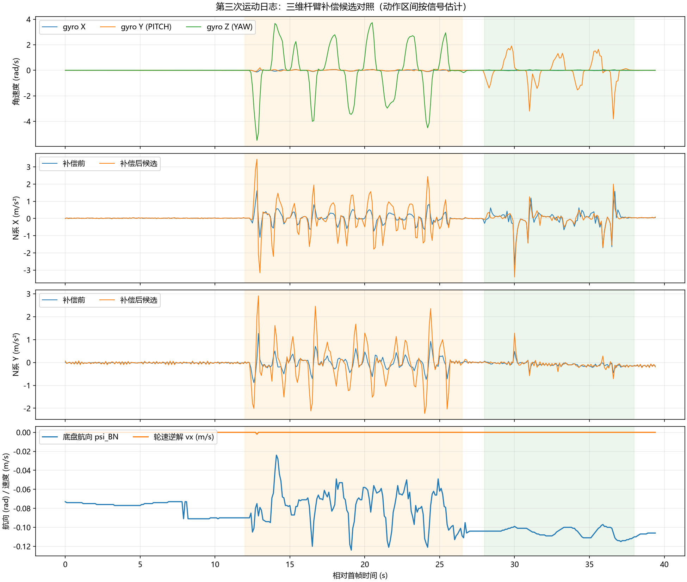

# 2026-10-26 第三次运动日志：三维杆臂补偿复测

来源：用户最新通道 0 文本，seq 14560～22440，395 组完整四行数据，首末跨度 39.399989 s。用户确认动作顺序为底盘固定：静止 → 只动 YAW → 静止 → 只动 PITCH → 静止，无底盘平移。下表的动作边界根据角速度近似划分。

全部文本字段见 [CSV 数据](20261026_第三次运动日志数据.csv)。本次仅分析与整理数据，未修改固件、PID、杆臂参数、融合或补偿开关。

## 结论

当前固件的三维杆臂校正路径已经运行，395 个输出样本均 corr=1；这仅表示样本满足计算条件，不表示校正正确或实车标定通过。本次 YAW 段校正后的水平加速度显著放大，PITCH 段总体也没有改善，不能放行 IMU 加速度融合和主动速度补偿。

仍为 mode=1、valid=0、exit=5、accel=0、obs=5，dv 始终为零，符合仅轮速诊断配置。此时 KF 输出接近零不能用于证明 IMU 校正正确。

## 日志与时效

| 项目 | 结果 |
| --- | --- |
| 四类完整日志 | 各 395 行，共 395 组 |
| 序号 | 相邻组均增加 20，无序号缺口 |
| 控制周期 dt | 4967～5016 μs |
| IMU 年龄 | 726～783 μs |
| 命令年龄 | 24～49 μs |
| wheel_mask | 始终 15，四轮在线 |
| qdrop | 始终 0 |
| tdrop | 始终 581，本次窗口内没有新增丢组 |
| KF flags / sat | 始终 0 / 0 |

581 是首帧之前已累计的 RTT 发送丢组，不能说本次 39.4 s 内又丢了 581 组。10 Hz 文本只记录抽样状态，不能保证未输出的控制帧也没有短暂异常。

轮速参考四轮始终为零，轮速反馈范围 LF [-30,12]、RF [-18,0]、LB [-19,107]、RB [-18,11] °/s，轮速逆解平移速度 vx [-2,0]、vy [-1,0] mm/s。支持本次为固定底盘试验，但轮速不能替代外部固定和真实运动确认。

## 补偿前后水平加速度

比较前先统一坐标：日志 nav_a 是 INS 导航系，而 center_a 是模块 N 系。以下补偿前使用 `(nav_a_x,-nav_a_y)`，与 center_a 同为模块 N 系，单位 m/s²。

RMS 定义为 `sqrt(mean(ax²+ay²))`，包含静态偏差和动态变化，未减均值。因为本次参考点固定，期望水平平移加速度接近零。

| 阶段，相对首帧时间 | 样本数 | 补偿前水平 RMS | 补偿后水平 RMS |
| --- | --- | --- | --- |
| 初始静止 0～12 s | 121 | 0.0284 | 0.0517 |
| YAW 约 12～26.5 s | 145 | 0.4561 | 1.2616 |
| 中间停顿约 26.5～28 s | 14 | 0.0260 | 0.0566 |
| PITCH 约 28～38 s | 101 | 0.5391 | 0.5962 |
| 末尾静止约 38～39.4 s | 14 | 0.1503 | 0.1646 |

YAW 补偿后约为补偿前的 2.77 倍，PITCH 约为 1.11 倍。部分较缓慢的 PITCH 局部区间有改善，不能因此忽略整段尖峰和总体结果。

YAW 段 seq=17120（t≈12.8 s）：补偿前 `(1.613,0.121)`，补偿后 `(3.448,2.041)` m/s²，实测 gyro_z=-5.5 rad/s。PITCH 段 seq=20560（t≈30.0 s）：补偿前 `(-2.698,0.484)`，补偿后 `(-3.404,1.282)` m/s²。

初始静止补偿后均值约 `(0.0175,-0.0172)` m/s²，末尾约 `(0.0450,-0.1476)` m/s²；末尾静止仅约 1.3 s，且 raw_a_x≈3.2 m/s²，俯仰姿态与开始不同，不能把残差变化直接当作恒定零偏并填入固定 N 系偏置。

## 待定位的轴向与动态问题

当前配置假设图中前方就是 INS 机体系 +X，因此杆臂在 INS 机体系为 `(0.084,0,0.037)` m。用户图只定义了物理跟随前方，还没有独立验证其与传感器轴的对应关系。这是模型假设，需要实测核对。

将 YAW 段水平加速度按 psi_GN 投影到传感器 X 轴的水平前向，筛选 |gyro_z|≥1 rad/s，共 72 个样本：

- 当前模型的径向旋转加速度 `nav-center` 方向为负，符合 +X 杆臂的理论向心项。
- 实测补偿前径向加速度对 gyro_z² 的过原点拟合斜率约 +0.0339 m，模型约 -0.0829 m，出现方向不一致。
- 该投影没有完整四元数，忽略小幅倾斜与动态时序误差；拟合量不能当作实测杆臂长度，不能直接据此把 8.4 cm 改为 3.4 cm 或反号。

方向不一致使“物理前向与传感器 X 轴映射”成为优先排查项，但现有日志不足以单独定论。姿态重力估计、真实安装位置以及动态滤波也可能参与。

代码中 INS 去重力加速度在机体系经过时间常数 8.5 ms 的低通，而杆臂模型使用未作同等低通的角速度及其约 5 ms 差分，存在动态不匹配。静止时角速度噪声经差分会放大，和静止段校正后 RMS 上升相符；是否为唯一原因尚未验证。当前数据不能支持只凭调整低通参数就认定问题已修复。

本次 |gyro_z| 最高 5.5 rad/s（约 315°/s），|gyro_y| 最高 3.812 rad/s（约 218°/s），属于较快运动，应先补充慢速和停稳验证。

底盘航向在 YAW 段为 -0.124～-0.024 rad，跨度约 5.73°；没有再次出现原先编码器符号错误导致的数弧度假转动，但动态残差仍存在。初始/中间停顿均值约 -0.0801/-0.1041 rad，本次并非完全没有航向变化。

## 下一轮采集

保持当前估计配置，先验证物理方向，再决定参数或代码修正：

1. 底盘固定，枪口放水平并静止 5 s，保留完整日志。
2. 在机构允许范围内缓慢上抬枪口约 10°，停稳保持 5 s，然后缓慢回水平并保持 5 s；明确记录“上抬”，用于结合 raw_a 和 gyro 判断物理前向与传感器轴的映射。不要只说正/负 PITCH，以免电机定义和物理方向混淆。
3. 枪口水平时缓慢左右转 YAW，约 20～30°/s，避免连续快速反向，每次停止保持 3～5 s。
4. 日志读取持续运行，末尾继续静止至少 5 s，并说明每个动作的方向和顺序。

下一轮优先看 raw_a_mmps2、gyro_mradps、nav_a_mmps2 和 center_a_mmps2；保持 corr 的有效性检查。先核对轴向，再处理角加速度差分噪声和加速度滤波时序，仍不放行融合或主动补偿。
