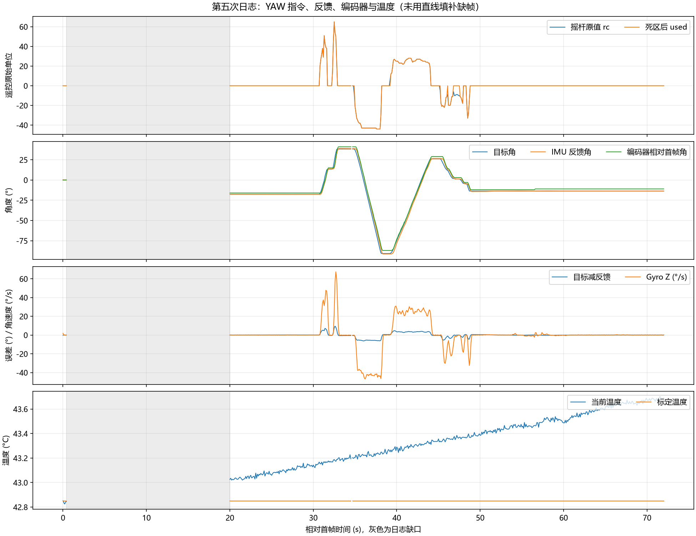

# 2026-10-26 第五次日志：YAW 诊断正常样本

来源：附件 3c87d103-6f6a-4b38-84bc-ae830b58ffe9/Pasted text.txt。用户确认前面几秒静止，后续转动均由本人遥控，本次没有云台自行转动。

字段已整理为 [CSV 数据](20261026_第五次YAW日志数据.csv)，缺失的 YAW 行留空。本次只分析数据，未修改固件、PID、死区、标定算法或安装参数。

## 结论

本次未复现间歇性自行右转，与用户观察一致。可见静止段的 used=0、目标角恒定、IMU 反馈角围绕目标小幅波动，不能将手动遥控期间的大角度变化当作自转。

本次上电标定通过（cal=1），没有超时回退固定零偏；42.8～43.7°C 的这次采集中也没有持续右转。因此此前“温漂或固定零偏回退”仍是未验证的排查方向，不能认定为已找到根因。当前样本开始时 IMU 已约 42.8°C，也不能用于排除冷启动时的问题。

## 数据完整性

| 项目 | 结果 |
| --- | --- |
| seq | 20～14420 |
| 首末时间跨度 | 71.999989 s |
| 完整底盘四行组 | 526 组 |
| 有效 YAW 诊断行 | 525 行 |
| 主要缺口 | seq 100 → 4020，相对首帧 0.399989 → 19.999989 s |
| 缺少日志组 | 195，与 tdrop 从 0 增到 195 一致；随后不再增加 |
| qdrop | 全程 0 |
| 控制周期 | 4965～5015 μs |
| IMU 年龄 | 735～790 μs |
| 命令年龄 | 24～47 μs |

用户所述开头静止数秒，在文件中实际只保留了最初约 0.4 s，随后到约 20 s 之间缺失。不能把这个缺口画成连续轨迹，也不能据此判断该段目标从 0° 到 -17.665° 的过程。

文件第 760 行（seq=6940）的 YAW 标签前缀损坏，其余数字看似可读，但没有校验依据，故未纳入 YAW 定量分析。该 seq 的底盘四行仍保留。仅凭这一处文本损坏不能认定 MCU 内存越界或控制故障。

## 摇杆与目标角

所有有效诊断样本均 src=1、online=1、gmode=2，为遥控在线的云台陀螺模式。rc 范围 -44～65，129 个非零原值样本；used 有 117 个非零样本，说明有 12 个小残差样本被死区屏蔽。

- 20～30 s：rc=used=0，目标恒定 -17.665°。
- 约 30.8～48 s：存在明确的正负摇杆输入，目标角随操作变化，范围约 -90.815～38.314°。用户确认这些均为主动操作。
- 50 s 之后：已记录样本均 rc=used=0，目标固定 -13.645°；没有可见的目标持续累加。

10 Hz 诊断无法证明中间每个 5 ms 控制帧都没有短暂输入；本次结论基于保留样本与用户观察，不作超出采样率的保证。

## 静止保持表现

| 区间 | 目标角 | 反馈角范围 | 目标减反馈 RMS | 上报编码器角 |
| --- | --- | --- | --- | --- |
| 20～30 s | -17.665° | -17.772～-17.651° | 0.0685° | 12° 恒定 |
| 60～72 s | -13.645° | -13.692～-13.584° | 0.0203° | 17° 恒定 |

最后 12 s 的反馈角端点变化约 -0.09°，线性拟合斜率约 -0.00192°/s；Z 陀螺反馈均值约 -0.00520°/s。未观察到持续单向大幅转动。

50～60 s 有小幅反馈调整，55～60 s 上报编码器从 16° 到 17°，不能描述成整段所有角度完全不变，也没有用户所述的持续自转。现有公共反馈 yaw_motor_single_round_angle 为 uint16_t，编码器角在发布前已经截成整度；即使日志名为 enc_mdeg，也不具备 0.001° 分辨率。因此编码器恒定不能排除小于 1° 的运动，稳态精度优先结合 IMU 反馈和物理观察。本次未修改公共协议。

手动运动窗口的目标跟踪 RMS 约 3.55°，包含转动、加速、减速和反向过程，不是静态误差；不能据此直接增加 Kp/Ki。

## 标定与温度

cal 全程为 1，cal_temp_mC=42849，表示本次静态标定在约 42.849°C 结束；bias_z_urps=24807，使用的初始 Z 零偏约 0.024807 rad/s，约 1.42°/s。这是已从原始陀螺读数中减去的校准量，不是校准后还存在 1.42°/s 漂移。

采集温度范围 42.825～43.700°C，过程中没有复现持续右转，不能仅凭温度上升就指认温漂是原因。若后续复现，继续保留 [YAW] 以便比较故障与正常启动。

## 底盘 IMU 补偿状态

mode=1、valid=0、exit=5、accel=0、obs=5、wheel_mask=15，与仅轮速诊断一致。corr=1，flags=sat=0；不代表加速度融合已获准。

约 30.7～49 s 的手动 YAW 窗口（含中途停顿），同一 N 系下补偿前水平加速度 RMS 约 0.1065 m/s²，补偿候选约 0.1318 m/s²；没有整体改善。静止 20～30 s，前后 RMS 约 0.0176/0.0257 m/s²。末尾 60～72 s 前后约 0.0624/0.0560 m/s²。当前仍需要核对动态差分噪声、滤波时序和姿态残差，不能凭静止 YAW 正常就打开加速度融合。

## 后续

保持当前固件与 PID，不因这段正常日志再次调整 YAW 参数。下次采集先让通道 0 持续读取，保存至少 10 s 完整静止段，再记录慢速 YAW/PITCH 和停稳段，避免丢失开头。若要专门复查间歇右转，应另留一次冷启动到温度稳定的连续记录，并说明故障实际发生时间；本次未复现，不能宣称永久修复。
