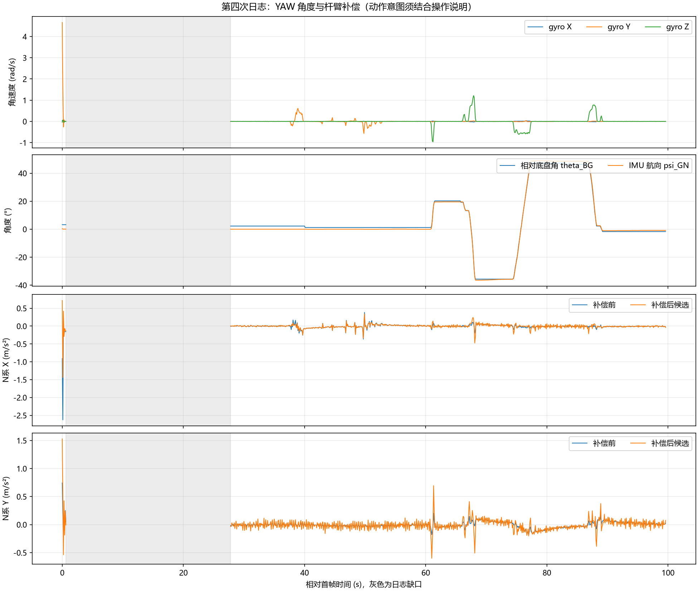

# 2026-10-26 第四次运动日志：回中死区与 IMU 安装方向

来源：用户附件 fa33f4b8-da58-41ba-b637-4bf7afd98265/Pasted text.txt。用户确认已经烧录 ±10 回中死区版本，云台不再自行向右转。动作顺序为静止、上抬 PITCH、停稳、回水平、缓慢左右转动 YAW、最后静止。

原始字段整理为 [CSV 数据](20261026_第四次运动日志数据.csv)。此日志采集于本次安装方向修正之前，不能用于证明修正后的实车效果。

## 主要结论

1. 遥控回中死区修正已有实车反馈：用户确认不再自行右转。日志最后约 9.6 s，YAW 相对编码器角 theta 始终为 -30 mrad，没有可见的持续单向转动；IMU 水平航向变化约 +0.172°。这支持本次工况下问题消除，不代表所有温度、姿态工况均已验证。
2. 已知上抬枪口时，静态 raw_a_x 显著变负，说明物理前向对应 INS 传感器 -X，推翻此前物理前向为传感器 +X 的假设。该假设造成了杆臂符号错误。
3. 本次修正速控私有安装映射：传感器系杆臂由 `(0.084,0,0.037)` 改为 `(-0.084,0,0.037) m`；物理 G 航向从传感器 +X 航向再加 π 获取。公共 INS、云台角度目标、PID 和编码器零位不作修改。
4. 保持 MC_IMU_ACCEL_VALIDATED=0 和 MC_ESTIMATE_ONLY。方向修正后的补偿效果尚须新日志验证，角加速度差分噪声和低通时序问题也仍需处理，不能直接开启融合。

## 完整性与运行状态

| 项目 | 结果 |
| --- | --- |
| 首末 seq | 20～19940 |
| 首末时间跨度 | 99.600011 s |
| 完整四行组 | 726 组 |
| 唯一日志缺口 | seq 140 → 5580，相对首帧 0.6 → 27.800011 s |
| 缺口组数 | 271，与 tdrop 从 0 增到 271 一致 |
| 后续发送丢组 | tdrop 保持 271，无新增 |
| 队列丢组 qdrop | 全程 0 |
| 控制周期 | 4965～5020 μs |
| IMU 年龄 | 739～796 μs |
| 命令年龄 | 24～51 μs |
| 模式与量测 | mode=1、valid=0、exit=5、accel=0、obs=5、wheel_mask=15 |
| corr / flags / sat | 全程 1 / 0 / 0 |

四轮参考均为零，逆解平移速度 vx=0、vy=0～1 mm/s，主动补偿 dv 为零。初始 0.6 s 包含 PITCH 角速度最高 4.662 rad/s，不能当作静止标定。缺失的 27.1 s 内无法判断云台轨迹或静止保持情况。

结尾出现 `(Connection lost)`，仅此文字不足以区分 RTT 断连、探针断连、MCU 复位或断电。此前输出的控制周期正常，不能据此判定控制卡死。

## 上抬动作给出的安装方向证据

| 阶段（相对首帧） | raw_a_x 均值 | raw_a_z 均值 | atan2(ax,az) |
| --- | --- | --- | --- |
| 上抬前 28～35 s | +0.327 m/s² | +9.829 m/s² | +1.91° |
| 上抬后停稳 40.5～45 s | -3.901 m/s² | +9.099 m/s² | -23.20° |
| 回水平后 55～60 s | -0.442 m/s² | +9.831 m/s² | -2.58° |

这些角度是静态重力投影的近似值，不是机械零位的精密测量。上抬时 gyro_y 为主要旋转分量且为正；停稳后 X 重力投影显著为负。结合用户明确的物理“上抬”方向，支持传感器 X 指向后方、Y 向右、Z 向上，与物理跟随系的映射为 diag(-1,1,-1)。因此物理前方 8.4 cm 应写作传感器 X=-8.4 cm，高度仍为传感器 Z=+3.7 cm。

回到水平后的倾角与开始约差 4.5°，手动回水平并非精确回到相同姿态，因此不能把前后原始 ax 差值当作加速度计零漂。

## 补偿候选仍未通过验收

下表使用模块 N 系同一坐标，补偿前为 `(nav_a_x,-nav_a_y)`；水平 RMS=`sqrt(mean(ax²+ay²))`，包含均值，单位 m/s²。

| 区间 | 补偿前水平 RMS | 补偿后候选 RMS |
| --- | --- | --- |
| 上抬前静止 28～35 s | 0.0184 | 0.0515 |
| 上抬动作 35～40 s | 0.0803 | 0.0819 |
| 抬起停稳 40.5～45 s | 0.0518 | 0.0702 |
| 回水平过程 45～55 s | 0.0810 | 0.0925 |
| 回水平后 55～60 s | 0.0231 | 0.0586 |
| YAW 操作窗口 60～89.5 s，含中途停顿 | 0.0758 | 0.1332 |
| 末尾静止 90～99.6 s | 0.0386 | 0.0626 |

YAW 最大 |gyro_z|=1.216 rad/s，约 69.7°/s，比上一次低，但仍有起停尖峰。候选加速度没有整体改善；静止段校正后的 Y 噪声仍约 0.05 m/s²，说明安装符号修正之外还要验证角加速度差分和加速度低通的动态一致性。

## 本次代码与验证

- `chassis_motion_config.h`：MC_IMU_HEADING_OFFSET_RAD=π，MC_IMU_LEVER_SENSOR_X_M=-MC_IMU_OFFSET_X_M，MC_IMU_LEVER_SENSOR_Y_M=MC_IMU_OFFSET_Y_M，Z=+0.037 m；中文注释说明来自第四次上抬实测。
- `chassis_motion_rigid3d_test.c`：解析参考直接使用独立安装测量 `(-0.084,0,0.037)`，不从生产配置宏生成参考值，避免安装符号错误时参考与实现同步出错。
- 完整运动模块主机回归通过：两种融合开关的 KF、四种平面安装组合、两种融合开关的三维解析运动与平移保留检查。标准 ARM 工程编译成功；既有 libc syscall/RWX 链接告警仍存在。
- 只估计模式下，航向的共同 π 偏置不改变 theta_BG，轮速参考由 theta_BG 解算；轮速到 N 再到 G 的共同旋转会抵消。公共云台控制不使用此安装偏置。当前未实车烧录验证。

下一次 psi_gn/psi_bn 的绝对值可能比旧日志相差约 3142 mrad，这是私有物理前向定义修正，应比较角度变化和编码器一致性，不要求绝对航向为零。

## 下一步

F5 烧录后，固定底盘并持续读取通道 0，记录水平静止 5 s、缓慢左右转 YAW（约 20～30°/s，每次停止 3～5 s）、缓慢抬起 PITCH 并保持 5 s、回水平后静止 5 s。优先比较方向修正后的 center_a 与补偿前水平加速度，维持 accel=0、valid=0、exit=5；不要提前放行融合。记录时不中断读取，避免再次丢失开头约 27 s。
