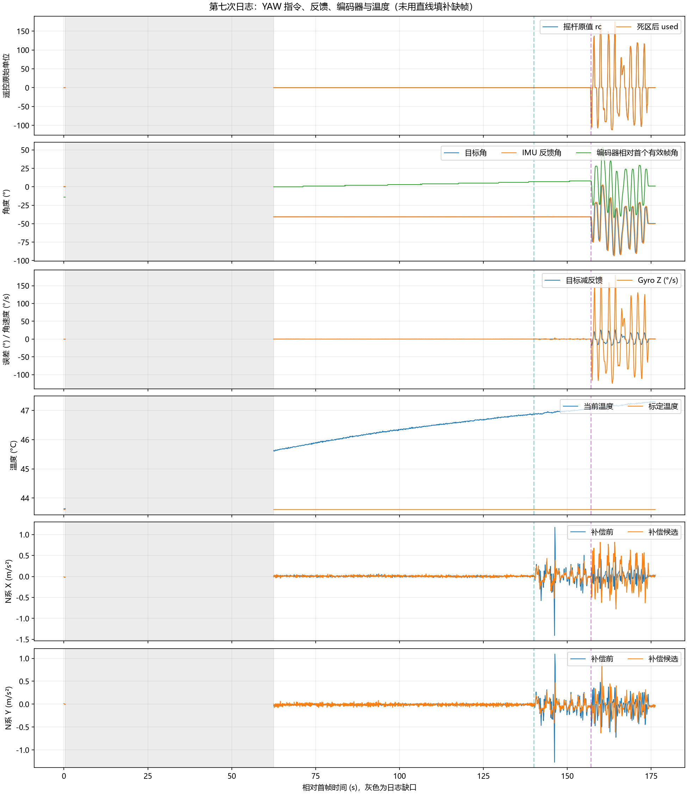

# 2026-10-27 第七次运动日志分析

来源：附件 49e5b4f9-66fe-4b2c-aa48-60bf05c05af5/Pasted text.txt。用户说明动作顺序为：先一直静止，然后缓慢转 PITCH，最后缓慢转 YAW。沿用前次固定底盘的采集条件分析；若本次底盘曾被搬动或转动，需要重新解释编码器与 IMU 的差异。

本次只新增分析脚本和记录，没有修改固件、PID、摇杆死区、零偏或安装参数，无需因此重新烧录。

原始字段整理见 [CSV 数据](20261027_第七次运动日志数据.csv)。时间相对本次首帧；灰色区表示日志缺口，青色虚线约 140 s 为 PITCH 阶段起点，紫色虚线约 157 s 为 YAW 阶段起点。编码器曲线减去了首个 corr=1 帧的角度，仅用于显示相对变化；它与 IMU 航向的零点不同。

## 结论

1. 本次终于有约 75 s 连续的无操作静止段：YAW 输入为零、目标角固定，编码器角却从 14° 逐渐变为 21°。在底盘固定的前提下，这是机械角慢漂移的较明确证据；IMU 反馈角稳定不能替代实际机械角稳定。
2. PITCH 段补偿候选的水平加速度 RMS 降低约 43%，但 YAW 段增加约 60%。补偿仍不能验收，加速度融合继续保持关闭。
3. 本次启动标定通过，但温度一直由约 43.6°C 升至 47.3°C。需要进一步核对航向残余零偏，不能仅凭温升确定故障原因。

## 数据完整性与状态

| 项目 | 结果 |
| --- | --- |
| 时间跨度 | 176.199609 s |
| seq | 20～35260 |
| 完整数据组 | 1143 组，STATUS/WHEEL/IMU/KF/YAW 各 1143 行 |
| 无法解析的行 | 0 |
| 缺口 | seq 100 → 12520，相对时间 0.400000 → 62.499620 s |
| 丢组 | 620，正好对应 tdrop 从 0 增至 620，随后不再增加 |
| qdrop | 全程 0 |
| 估计器周期 | 4954～5015 μs |
| IMU 年龄 | 238～801 μs |
| 命令年龄 | 23～48 μs |

开头仍只有 5 组，约 0.4 s；接下来约 62 s 日志未保留。tdrop 是日志输出丢组计数，不表示控制任务停止。缺口后的约 62.5～140 s 仍提供了足够长的连续静止窗口，本次不需要再单纯重复同样的长时间静止采集。

开头 5 组为 exit=1（MC_EXIT_DISABLED）、wheel_mask=0、obs=0、corr=0，尚不能用于轮速或杆臂补偿验收。恢复日志后为 wheel_mask=15、obs=5、corr=1、exit=5（MC_EXIT_IMU）。无法判断缺口中这些状态具体何时变化。

全程 mode=1、valid=0、accel=0、flags=0、sat=0，与当前仅估计诊断、禁止加速度融合的配置相符。exit=5 不等于 IMU 硬件损坏；当前 MC_IMU_ACCEL_VALIDATED=0 本身就阻止融合验收放行。

## 静止段：约 65～140 s

选取这一窗口避开日志刚恢复的边缘，共 750 个样本。

| 指标 | 结果 |
| --- | --- |
| YAW 原始输入 rc、死区后 used | 全部为 0 |
| 目标角 | 恒定 -40.693° |
| IMU 反馈角 | -40.799～-40.590° |
| 目标减反馈 RMS | 0.0623° |
| 编码器上报角 | 14° → 21° |
| 编码器拟合趋势 | 约 +0.088°/s，约 5.3°/min |
| 四轮上报转速与底盘角速度 | 全部为 0 |
| 温度 | 约 45.677～46.884°C |

编码器整体约每 10～13 s 增加 1°，不是单个离群点。公共反馈已截成 uint16_t 整度，enc_mdeg 的打印缩放不能提供毫度精度；拟合值只是长期趋势，不是精确实时转速。现有日志也不能仅凭角度增大的符号就指定肉眼观察的左转或右转方向。

“目标固定、IMU 航向基本固定、相对编码器却逐渐变化”与航向估计残余漂移被控制器追随的表现相符。代码中姿态 EKF 利用重力约束姿态，Z 轴 GyroBias 固定为 0，缺少独立航向参考；正常完成启动标定仍不能保证之后航向完全不漂。当前只能将残余零偏列为优先排查方向，不能证明它就是唯一原因。

静止段 gz 的平均值约 -0.0051°/s，不能直接拿它否定编码器趋势：gz 是已校准的传感器 Z 轴角速度，云台存在俯仰，且机械系统正处于反馈闭环。它不是独立测量的真实航向角速度。不要从这组数据直接写入固定的 0.088°/s 反向补偿；不同启动与姿态下趋势可能不同，上一组的方向就与本组不同。

## PITCH 与 YAW 补偿

按用户动作顺序和角速度、摇杆数据划分窗口。同一组 seq 同时用于输入、姿态和加速度统计；YAW 诊断的 cmd_t_us 相对底盘采样约晚 5 ms，不能视作精确同步的原始控制帧。

水平 RMS = sqrt(mean(ax² + ay²))，未减去均值；补偿前采用模块 N 系 (nav_a_x, -nav_a_y)，补偿后使用 center_a。只统计 corr=1 的帧，单位 m/s²。

| 阶段 | 相对时间 | 样本数 | 补偿前 RMS | 补偿候选 RMS | 变化 |
| --- | --- | --- | --- | --- | --- |
| 无操作静止 | 65～140 s | 750 | 0.0218 | 0.0334 | 小量噪声有所增加 |
| PITCH | 140～157 s | 170 | 0.3041 | 0.1731 | 降低约 43.1% |
| YAW | 157～175 s | 180 | 0.2401 | 0.3842 | 增加约 60.0% |
| 末尾窗口 | 175～176.3 s | 13 | 0.0471 | 0.0481 | 窗口过短，不能验收稳态 |

PITCH 的 X/Y 分量 RMS 分别从 0.2259/0.2036 降至 0.1310/0.1131；水平分量峰值也从 1.408/1.269 降至 0.524/0.470。本次说明这段 PITCH 动作中杆臂补偿有明显作用，不能解释成安装参数已经精确标定。

YAW 的 X/Y 分量 RMS 则分别从 0.1347/0.1987 增至 0.3212/0.2108，X 分量恶化尤其明显。当前角加速度由角速度差分产生，而加速度已经过 INS 低通，两条路径的滤波、延迟及差分噪声仍需核对。10 Hz 打印不足以重建完整的 200 Hz 差分过程，不能根据打印曲线随意拟合新杆臂长度或认定某个延迟就是根因。

实际采样峰值：PITCH Y 角速度绝对值 3.011 rad/s，约 172.5°/s；YAW Z 角速度最高约 179.3°/s。即使主观操作较缓慢，转向或拨杆时仍有较快运动，因此本次不是纯粹的 20～30°/s 低速测试。

YAW 主动操作时目标跟踪 RMS 约 10.85°，包括快速转动和反向，不能用它当静态精度或据此直接调大 PID。末尾只保留约 1.2 s，反馈仍在收敛，不能证明最终停稳误差。

## 温度与标定

全程 cal=1，cal_temp_mC=43607，即本次启动标定在约 43.607°C 结束；bias_z_urps=25091，即采用初始 Z 零偏 0.025091 rad/s，约 1.44°/s。这是已经从原始读数减掉的校准量，不是剩余漂移速度。

本次记录温度范围 43.619～47.315°C，结束时约 47.288°C，温度没有达到平台。结合静止段趋势，温度变化后的残余零偏值得验证；也可能包含标定时未完全静止或其他姿态相关误差。仅凭现有字段不能断定是温控失效、传感器故障或 PID 错误。

## 下一步

先保留当前固件与通道 0 文本输出，不开启加速度融合，也不继续扩大摇杆死区。已有静止段 rc=used=0，扩大死区无法解释或消除这段机械角变化。

1. 优先做一次不同条件的零偏复查：等温度变化明显变慢后，再在整机完全不动的条件下重新启动标定。随后固定底盘、保持 PITCH 角不变、松开摇杆记录 60 s，并用固定参照确认 YAW 的实际变化方向。比较重新标定后编码器趋势是否显著减小。不要把最终温度预设成 40°C，应以实际平台为准。
2. 补偿路径下一项代码核对为加速度与角加速度的滤波和时序。现有 10 Hz 文件不足以直接验证 5 ms 差分细节；保持当前实测杆臂，避免同时改变多个因素。
3. 后续动作测试更轻地拨杆，目标约 20～30°/s；YAW 的 gz_mdps 绝对值尽量在 20000～30000 附近，PITCH 的 gyro_mradps 第二项约 350～520。两个角速度在非水平姿态下不完全等价于轴实际转速，此处只是低速采集的参考。每次反向前停 5 s，最终静止至少 10 s。

继续读取通道 0，避免启动后长时间无人读取导致输出丢组。当前文件的问题是开头缺口，并没有出现乱码或坏行。
