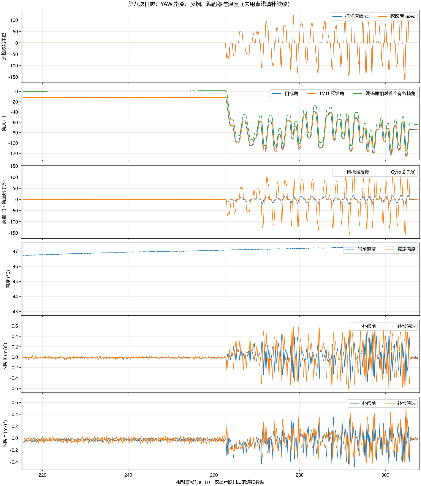

# 2026-10-27 第八次运动日志分析

来源：附件 a395817b-94bc-478d-8a74-40b92cf73122/Pasted text.txt。用户确认按“温度稳定后重新上电标定 → 底盘固定静止 → 只转 YAW”的流程采集。本轮未单独明确回答肉眼是否观察到静止时偏转，故以下机械角变化判断依据编码器记录。

本次未修改固件、零偏、死区、PID 或安装参数，仅新增分析脚本、数据和报告，无需重新烧录。

字段见 [CSV 数据](20261027_第八次运动日志数据.csv)。图仅显示相对首帧约 215.5 s 之后的连续数据；紫色虚线约 262.8 s 为首次记录到非零 YAW 有效输入的时刻。编码器曲线相对首个 corr=1 帧归零，与 IMU 航向采用不同零点。

## 结论

- 静止窗口约 216～262 s，rc=used=0，目标固定，IMU 反馈基本稳定，但编码器角从 87° 变为 89°。仍有慢漂移迹象，不能认定完全消除。
- 本窗口编码器拟合趋势约 +0.028°/s，上一组约 +0.088°/s。本次趋势较小，但姿态、温度和观察时长不同，整度量化影响也较大，不能据此宣称标定方法已验证有效或精确改善某个百分比。
- YAW 动作段的水平加速度残差 RMS 从 0.2350 增至 0.3152 m/s²，补偿后增大约 34.1%，尚不能开启加速度融合。
- 用户已按温稳重启流程操作，但记录中的标定温度为 42.963°C，后续静止段温度约 46.7～47.1°C。本文件仍不足以验证“同一稳定温度下标定与运行”的效果。

## 数据完整性

| 项目 | 结果 |
| --- | --- |
| seq | 20～61540 |
| 首末帧时间跨度 | 307.599623 s |
| 完整日志组 | 927 组，五类标签各 927 行 |
| 无法解析的行 | 0 |
| 主要缺口 | seq 100 → 43120，时间 0.400000 → 215.499611 s |
| 缺少组数 | 2150，恰好对应 tdrop 从 0 增至 2150 |
| 缺口后 | tdrop 保持 2150，无新的丢组 |
| qdrop | 全程 0 |
| 估计器周期 | 4970～5016 μs |
| IMU 年龄 | 237～872 μs |
| 命令年龄 | 22～47 μs |

文件保留最初 5 组、约 0.4 s，然后直接跳到约 215.5 s，随后连续记录约 92.1 s。2150 是缺少的日志组数，并不表示控制任务停止了 215 s。缺口内的温度、动作和反馈状态不能还原，也不能把目标从 0° 到 -11.655° 的变化解释成自动转动。

最初 5 组为 exit=1（禁用）、wheel_mask=0、obs=0、corr=0。日志恢复后为 wheel_mask=15、obs=5、corr=1、exit=5（IMU 融合条件未放行）。MC_IMU_ACCEL_VALIDATED=0 仍是禁止融合的预期配置；exit=5 本身不能证明 IMU 硬件故障。

全程 mode=1、valid=0、accel=0、flags=sat=0。当前仍处于估计诊断阶段，补偿候选没有进入加速度融合或主动速度补偿。

## 静止段

选取 216～262 s，共 460 个样本，避开日志恢复边缘并在手动 YAW 输入前结束。

| 指标 | 结果 |
| --- | --- |
| rc、used | 全为 0 |
| 目标角 | 恒定 -11.655° |
| IMU 反馈角 | -11.756～-11.552° |
| 目标减反馈 RMS | 0.0643° |
| 编码器上报角 | 87° → 89° |
| 编码器拟合趋势 | 约 +0.0276°/s，约 +1.66°/min |
| 四轮上报转速、底盘角速度 | 全为 0 |
| 温度 | 46.710～47.085°C |

编码器大部分时间为 88°，后段在 88°/89° 附近有往返量化跳变，不能将每个 1° 台阶都解释成瞬间旋转 1°。当前公共反馈在发布前已截成整度，enc_mdeg 的缩放打印不具备毫度分辨率。长期从 87° 到 89° 的变化提示机械角缓慢变化，但拟合趋势只能粗略参考。

这与“目标角固定，控制器跟随残余航向漂移”的可能性相符，尚不能证明唯一根因。姿态 EKF 缺少独立航向参考，启动标定通过也不保证热态零偏完全不变。gz 是已校准的机体系 Z 轴读数，不是独立的真实机械转速，静止段均值接近零不能替代编码器观察。

与上一组相比，本次静止时 raw_a_x 均值约 -0.019 m/s²，而上一组约 +1.583 m/s²，提示两次俯仰姿态不同；标定温度、零偏、时长也不同。因此不能直接用两次编码器斜率相除来宣布改进幅度，更不能把本次拟合值写成固定反向补偿。

## 温度与标定

cal 全程为 1，cal_temp_mC=42963，bias_z_urps=24003：本次标定通过，标定结束温度约 42.963°C，采用的初始 Z 零偏为 0.024003 rad/s，约 1.375°/s。这是已经减去的校准量，不是剩余漂移。

整段可见温度范围 42.942～47.342°C。缺口后静止段温度变化较慢，但比标定结束时高约 3.7～4.1°C。需要区分“当前温度已经比较稳定”和“零偏是在当前温度下标定”这两个条件。本日志只能支持前者接近满足，不能验证后者。

不能根据这个差值认定用户没有按流程操作，也不能据此断定加热控制、驱动器或 MPU6500 故障。下次若专门验证同温标定，应先检查日志中的 cal_temp_mC 与运行 temp_mC 是否接近，再比较机械漂移；不要只根据等候时长判断。

## YAW 动态与补偿

首次非零 used 约在 262.805 s，最后一次约 305.405 s。src=1、online=1、gmode=2 全程一致；rc 范围 -161～130，273 个原值样本非零，used 有 255 个非零样本，18 个小输入样本被屏蔽。没有明确 PITCH 操作段，与用户确认一致。

水平 RMS = sqrt(mean(ax² + ay²))，未减均值；补偿前采用模块 N 系 (nav_a_x, -nav_a_y)，补偿后使用 center_a。按同组 seq 取样，排除 corr=0 帧，单位 m/s²。

| 窗口 | 样本数 | 补偿前 RMS | 补偿候选 RMS | 判断 |
| --- | --- | --- | --- | --- |
| 静止 216～262 s | 460 | 0.0359 | 0.0462 | 低幅残差增加 |
| YAW 262～306.3 s | 443 | 0.2350 | 0.3152 | 增加约 34.1% |
| 末尾 306.3～307.7 s | 14 | 0.0278 | 0.0352 | 太短且仍在收敛，不作为停稳验收 |

YAW 段 X 分量 RMS 从 0.1736 增至 0.2695，Y 分量从 0.1585 变为 0.1634，主要问题仍在 X 分量。采样到的 Z 角速度约 -160.7～+136.6°/s，仍不是纯粹的 20～30°/s 低速测试；动态目标跟踪 RMS 约 9.05°，含加速、反向和跟踪滞后，不是静态误差。

当前角加速度通过角速度差分得到，而 INS 加速度已经低通，两条路径的动态响应与延迟不一致需要核对。10 Hz 日志不能重建完整 200 Hz 差分过程；不能靠这些点精确拟合延迟、改动杆臂或确认根因。现有多个样本已足够说明 YAW 补偿未通过，继续重复同样的快速左右摆动不会解决该问题。

末尾目标固定为 -73.730°，反馈从 -72.778° 向 -73.714° 收敛，仅保留约 1.3 s。该段编码器由 24° 变为 23°，与减速收敛同时发生，不能单独归为松杆后的异常持续自转。

## 下一步

保留 MC_IMU_ACCEL_VALIDATED=0，不继续扩大摇杆死区，也不根据本次统计直接修改 PID 或添加固定航向反向补偿。

下一项实现核对应集中于补偿路径的角加速度差分、滤波与时间对齐。航向漂移则需要以 cal_temp 与运行温度接近、俯仰姿态一致的条件比较，避免把多个条件同时变化当作修复效果。

无需因本次分析重新烧录。若再做动作采集，轻拨摇杆并查看 gz_mdps，目标绝对值约 20000～30000；每次反向前停 5 s，结束后保留至少 10 s。持续读取通道 0，避免再次失去上电后数分钟的数据。
