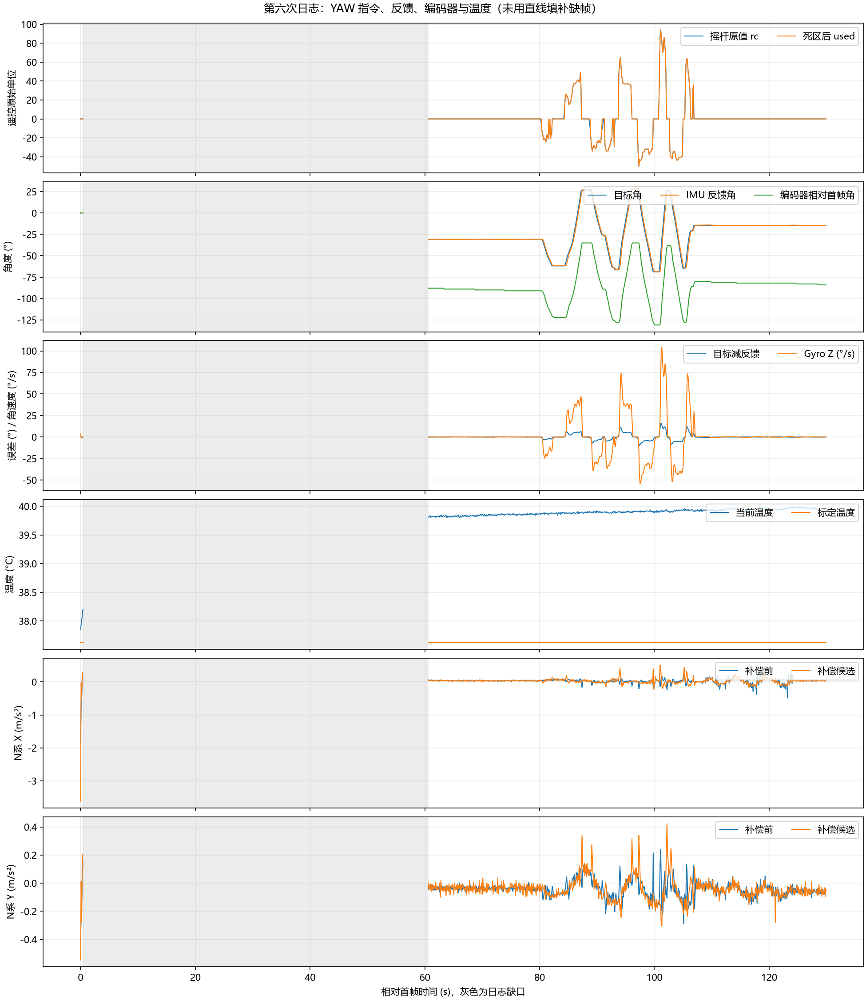

# 2026-10-27 第六次运动日志分析

来源：附件 c27a03cd-fd2a-4708-af0a-19a494651129/Pasted text.txt。用户确认：底盘固定，先静止，再左右缓慢转 YAW，再上下缓慢转 PITCH；没有再次观察到松杆后持续自行右转。

本次只分析日志，未修改固件、PID、摇杆死区、标定算法或安装参数。

解析数据见 [CSV](20261027_第六次运动日志数据.csv)。时间均相对本次首帧，灰色区为日志缺失区，不用直线补齐轨迹。

## 主要结论

PITCH 段的水平加速度补偿候选有一定改善；YAW 段仍比补偿前更差，尚不能通过补偿验收，也不能开启加速度融合。

本次没有复现用户此前描述的持续自行右转，但仍有小幅慢漂移迹象：在无 YAW 输入、目标角固定的约 65～79 s，编码器上报角从 12° 逐步变为 10°，IMU 反馈角却基本保持目标。因此不能仅凭反馈角稳定认定机械角完全不动。

## 数据完整性

| 项目 | 结果 |
| --- | --- |
| 首末帧跨度 | 129.900015 s |
| seq 范围 | 20～26000 |
| 完整日志 | STATUS、WHEEL、IMU、KF、YAW 各 699 行，699 组完整 |
| 主要缺口 | seq 100 → 12140，相对时间 0.400014 → 60.600000 s |
| 缺失组数 | 601，恰好对应 tdrop 从 0 增至 601，之后保持不变 |
| qdrop | 全程 0 |
| 估计器周期 | 4970～5015 μs |
| IMU 年龄 | 735～793 μs |
| 命令年龄 | 24～47 μs |

最初静止过程实际只保留约 0.4 s，随后约 60 s 的日志未保留。tdrop 表示日志输出丢组，不能据此说控制任务停止了 60 s，也无法还原缺口内的动作。最初几帧还包含较大 PITCH 角速度瞬态，不适合作静态零偏标定样本。

## 分段补偿结果

水平加速度 RMS 定义为同一 N 坐标系下 sqrt(mean(ax² + ay²))，单位 m/s²；未减去各段均值。底盘固定时，水平平移加速度应接近零，因此该指标用于比较残差。表内为选定窗口的采样统计，不能代表所有转速或姿态。

| 阶段 | 相对时间 | 样本数 | 补偿前 RMS | 补偿候选 RMS | 判断 |
| --- | --- | --- | --- | --- | --- |
| YAW 操作前保持 | 65～79 s | 140 | 0.0536 | 0.0579 | 略增 |
| YAW 左右操作 | 80～108 s | 280 | 0.1096 | 0.1446 | 增加约 31.9% |
| PITCH 上下操作 | 108～125 s | 170 | 0.1389 | 0.1111 | 降低约 20.0% |
| 末尾停稳窗口 | 125～130 s | 50 | 0.0688 | 0.0725 | 略增 |

PITCH 段主要改善在 N 系 X 分量：RMS 从 0.1236 降至 0.0898；Y 分量从 0.0634 变为 0.0654，并没有同步改善。不能将合成值下降解释成三维补偿已完全正确。

YAW 段 N 系 X/Y 分量都变差。现有实现的加速度来自 INS 低通后的量，角加速度则由角速度差分得到，两条路径的滤波与延迟还需核对；差分噪声也是待验证因素。本次数据不能单独确定根因，不应凭此随意改动实测杆臂长度。

虽然操作描述为缓慢，已采样到的 YAW Z 角速度峰值约 104°/s，PITCH Y 角速度峰值约 49°/s。下一次需要更轻地拨杆，保留低速段和反向停顿，便于区分动态滞后与噪声。

## YAW 输入与慢漂移

全程 src=1、online=1、gmode=2。YAW 摇杆原值范围 -50～94，189 个样本非零；死区后 used 有 176 个样本非零，13 个小输入样本被屏蔽。主动操作集中在约 80～107 s，与用户描述相符。

65～79 s，rc=used=0，目标固定 -30.830°；IMU 反馈范围 -30.939～-30.727°，目标减反馈 RMS 约 0.0605°。同时编码器角由 12° 变为 10°，拟合趋势约 -0.18°/s。在底盘固定的前提下，这提示云台机械角仍可能缓慢移动。

需要注意：公共编码器反馈在发布前已转换为 uint16_t 整度值。即使日志叫 enc_mdeg，实际分辨率仍约 1°，不能宣称有 0.001° 测量精度，也不能用短短几秒的台阶变化精确计算转速。此处约 14 s 的连续单向趋势值得复查，但不能据此认定已经复现此前的明显持续右转。

“IMU 反馈基本固定而编码器缓慢变化”的表现与残余航向漂移、控制器追随漂移的可能性相符，但尚未证明是陀螺温漂、启动标定、机械因素或其他原因。当前诊断按 10 Hz 输出，也不能排除两个记录点之间的瞬时输入。暂不扩大死区、不增加积分、不加入未经验证的在线零偏修正。

## 标定与温度

cal 全程为 1，表示启动标定通过，没有超时回退。cal_temp_mC=37626，即标定结束时约 37.626°C；bias_z_urps=23697，即采用的初始 Z 零偏为 0.023697 rad/s，约 1.358°/s。这是已经减掉的校准量，不是剩余漂移速度。

记录温度从约 37.859°C 上升至接近 40°C，最高 40.001°C。65～79 s 的慢漂移迹象发生在约 39.806～39.878°C。标定温度与运行温度不同，需要保留温度诊断进行比较；仅凭温差不能确定温漂就是原因。

## 底盘估计状态

全程 mode=1、valid=0、exit=5、accel=0、wheel_mask=15、obs=5，仍处于估计与诊断阶段，加速度融合未启用。corr=1 表示补偿候选路径有输出，不代表验收通过；flags=sat=0 也不能替代动态精度验证。

## 下一次采集

无需为本次分析重新烧录，继续使用当前固件与通道 0 文本日志。

1. 先让 RTT Viewer 持续读取通道 0，再开始保存。确认 seq 连续、tdrop 在本次采集中不再增加，避免再次丢失开头约一分钟。
2. 底盘固定、摇杆完全松开，先连续记录 30～60 s。用固定参照观察 YAW 是否缓慢偏移，记录发生时间；保留 YAW 的 rc、used、ref_mdeg、fb_mdeg、enc_mdeg、gz_mdps、temp_mC 和 cal 字段。
3. 接着尽量以 20～30°/s 左右缓慢转 YAW，左右各一次，每次反向前停 5 s；结束后静止 10 s。
4. 再缓慢上下转 PITCH，每次反向前停 5 s，结束后静止 10 s。说明最后是否回到初始水平姿态。

先获得完整静止段确认慢漂移，再核对补偿路径的滤波和时序；当前数据不足以开启加速度融合。
