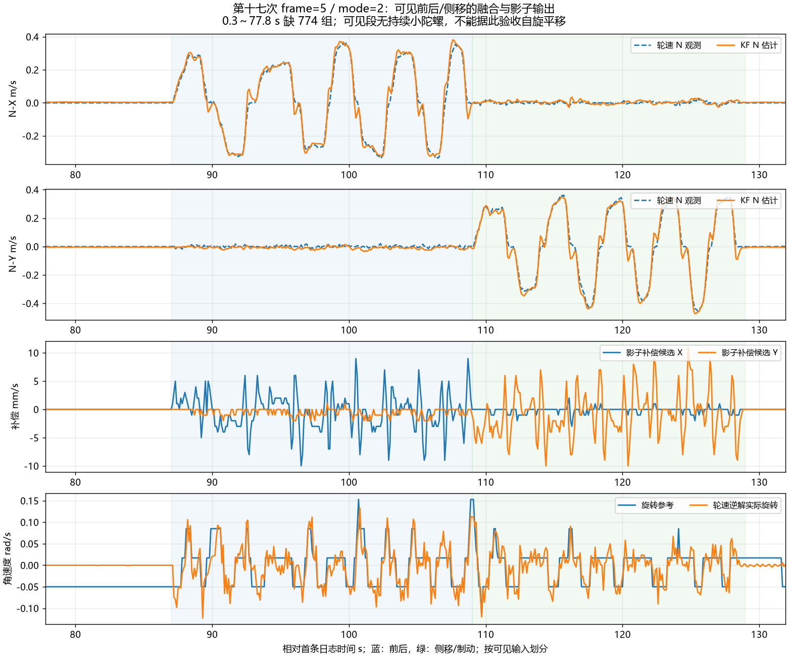

# 第十七次运动日志：固定小增益主动补偿试运行

原始附件：`C:/Users/xuzih/.codex/attachments/6365e7c0-0f4e-4499-ae9c-63ce64360256/Pasted text.txt`。

**结论：可见前后/侧移的融合方向和影子候选正常；用户另行确认“小陀螺我单独测试过没啥问题”。准备 frame=6，以 Kp=0.1 进入固定主动补偿试运行。**小陀螺正常属于用户实车反馈，不能冒充本文件记录到了完整自旋平移。

## 1. 文件完整性

共 546 组完整五行，跨度 131.900 秒，全部 `fw=20261030 frame=5 mode=2`。时间均相对首条日志。

- 首组 `valid=0 exit=8` 是启动恢复，其余 545 组均 `valid=1 exit=0`。
- 全部 `accel=1 obs=15 wheel_mask=15 corr=1`，可见记录没有观测关闭或矩阵异常退出。
- 全部 `cmd_g_mmps=ref_g_mmps`，符合影子模式；除首组外 `kp_x1000=100`。
- 全部 `flags=0 sat=0`；没有记录到输出限幅/电流饱和标志。
- `qdrop=0`；0.300～77.800 秒缺 774 组，与 `tdrop` 从 0 升至 774 一致。缺口之后的 seq 连续，未继续丢组。不能将文本发送丢组直接等同控制停摆，也不能据此推断缺口内控制正常。
- 可见旋转参考绝对最大 0.153 rad/s，实际轮速逆解绝对最大 0.133 rad/s，主要是跟随模式微调，未记录持续小陀螺。
- 收到 55 个高频窗口，窗口号为 1、78～131；累计 good=55076、bad=1，采样间隔 569～1438 μs。唯一拒绝位于第一个启动窗口，`reject=1`；不应将其说成全段持续异常。`ddrop` 从 0 到 76，与缺失秒窗一致。

温度从约 34.8 升至 40.1°C，启动标定约 34.6°C。可见段没有因此失效，但这次并非严格恒温对照，不能把所有差值变化归因于某一个代码参数。

## 2. 可见运动指标

阶段根据可见用户输入划分：87～109 秒以前后为主，109～129 秒侧移及制动，最后静止。阶段边界包含斜坡和刹停过渡。

| 阶段 | 时间 | KF−轮速二维差值 RMS | 差值峰值 | 实际影子补偿峰值 |
| --- | --- | ---: | ---: | ---: |
| 可见静止 | 78～85 s | 0.0062 m/s | 0.0072 m/s | 打印为 0 |
| 前后 | 87～109 s | 0.0366 m/s | 0.1140 m/s | 0.0100 m/s |
| 侧移及制动 | 109～129 s | 0.0396 m/s | 0.1149 m/s | 0.0110 m/s |
| 最后静止 | 129～131.9 s | 0.0058 m/s | 0.0076 m/s | 打印为 0 |

连续运动片段内的轮速低频差分与中心加速度相关系数：前后 X 为 +0.817，侧移 Y 为 +0.841，方向一致。差分舍弃片段首末各三点，不跨缺口。这是方向证据，不是精确加速度比例标定。

全部影子候选峰值 0.011 m/s；与 `0.1*err_g` 的二维差值最大约 0.00127 m/s，处于日志整数截断/补偿斜坡造成的小差值范围。静止时打印为 0 可能只是小于 1 mm/s，不能声称补偿严格为零。末条估计约 `(0.004,-0.006) m/s`。

KF 本身使用轮速观测，二者差值不是独立外部测速误差；本次也没有主动补偿的实际闭环结果。允许进入小增益试运行，不代表全工况验收完成。



## 3. 新版行为

`chassis_motion_config.h` 改为：

```c
#define MC_FRAME_REVISION 6u
#define MC_DEFAULT_MODE MC_ACTIVE_FIXED
```

保留已有 `MC_FIXED_KP=0.10f`、补偿向量上限 0.10 m/s、补偿变化率 0.5 m/s²、用户平移上限 1.0 m/s。继续使用 frame=5 的坐标与小陀螺修复、原 KF 方差和实测杆臂，不修改公共协议、遥控器死区、速度映射、电机方向或转速调度。

新鲜联合观测恢复满 20 次且输出允许时，`cmd_g=ref_g+dv_g`，补偿实际进入四轮速度参考。估计失效或恢复未完成时 `dv_g=0`，退回原参考；输出禁止时四轮立即为零。原有执行限制、限幅、时间戳和模式切换保护继续作用。

退回影子可将默认值改回 `MC_SHADOW` 重新构建，或在正常底盘调试入口调用 `ChassisMotionSetMode(MC_SHADOW)`。构建前 frame=5 的源码/固件保存在 `build/before_20261030_active_fixed/`。

## 4. 验证与固件

新增生产默认用例直接检查实际四轮输出：参考 0.20 m/s、反馈 0.15 m/s，恢复后补偿约 +0.005 m/s，四轮参考与独立 J 手算的 0.205 m/s 对应。另验证：

- 启动未恢复时不追加补偿。
- 加速度无效时立即撤掉补偿，重新连续有效 20 次后才恢复。
- 退回纯估计/影子时输出不携带旧补偿；切回主动遵守补偿斜坡。
- 输出禁止立即清零实际四轮参考。

通用基线测试显式选择纯估计模式，避免测试基线随上电默认变化。完整主机回归通过，包含正反自旋、多圈角度跨界和三种补偿模式。历史二进制解码回归通过，日志解析缺口核账及完整性断言通过，图像已渲染检查。

ARM 构建通过：text=95984、data=1120、bss=85744 字节；仍有原裸机系统调用和 RWX 链接告警。固件为工程既有 `build/basic_framework_ATYPE.elf/.hex/.bin`，本次未执行烧录。

ELF SHA256：`20FB1D9E4F81431EA4CEB6D9DB620F6B44EA8CDECC843E6A620400D894C3D158`。

## 5. 下一次只检查主动闭环

烧录确认 `fw=20261030 frame=6 mode=3`，恢复后预期 `valid=1 exit=0 accel=1 kp_x1000=100`。两轴 `cmd_g` 应随 `ref_g+dv_g` 变化，三个字段分别截断为整数，逐轴文本相加允许约 1 mm/s 差值。旋转参考仍用 `omega_ref_mradps` 观察。

先打开 RTT 并确认时间戳连续推进，再做约 30～40 秒：静止约 5 秒 → 低速前后并停车 → 低速侧移并停车 → 静止约 10 秒。观察停车后是否出现持续爬行、前后振荡或云台动作带动底盘移动；若出现立即停止测试并说明所处阶段。此次用于验证小增益主动闭环，不要求重复长时间仅转云台的标定。小陀螺方向已经有用户确认，不再要求先重做整套方向试验。

如果 `tdrop` 只是启动时累计少量增加，后续保持不变，可按连续段分析；若在动作过程中持续增长，先保证 RTT 接收持续运行，避免再次丢失关键动作。日志传输保持非阻塞，不通过阻塞控制任务补齐日志。

## 6. 分析产物

- `20261030_第十七次运动日志数据.csv`：546 组原字段与相对时间。
- `20261030_第十七次高频诊断数据.json`：55 个 RIGID/AID 原窗口。
- `20261030_第十七次运动日志分析.png`：可见段速度、实际影子候选及旋转参考。
- `build/analyze_motion_seventeenth.py`、`build/motion_text_analysis_17.json`：原文件复现解析及统计。
