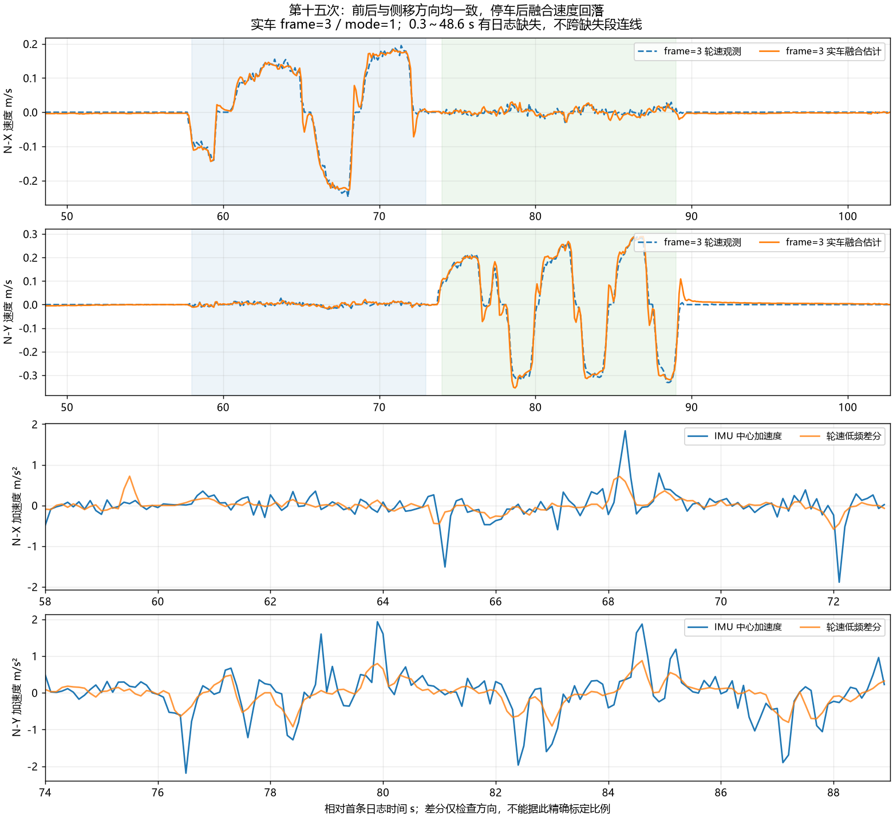

# 第十五次运动日志：两轴方向确认，默认进入影子补偿

原始文件：`C:/Users/xuzih/.codex/attachments/0cd00cfc-ec26-413b-a7a8-0c07b383909f/Pasted text.txt`。

用户确认全程落地，先静止，约 58～72 秒前后移动、74～89 秒左右侧移，最后静止；无打滑、碰撞，云台保持中位。时间均相对首条日志。

## 1. 本次结论

**frame=3 的实际落地数据已确认前后、侧移两轴方向一致，可以进入影子补偿。加速度已经参与 KF 融合；影子模式进一步计算补偿候选，不把候选追加到电机。**

此前第十三次的 X 航向多余 π、第十四次的旧轮速 Y 与姿态 B 的 Y 反射问题，是有实车符号证据支持的代码坐标问题。本次不再改航向、Y 符号或安装杆臂。8.4 cm 前向、3.7 cm 上向继续按 MPU6500 芯片中心的实测值使用；本次不能据此证明尺寸绝对准确，但没有证据支持靠继续改尺寸解决此前的方向错误。

轮速观测和 KF 不是独立真值，因此下表表示两者一致程度，不等于外部测速精度或实车速度误差。

| 阶段 | 相对时间 | KF 与轮速的二维差值 RMS | 差值峰值 |
| --- | --- | ---: | ---: |
| 动作前可见静止 | 49～57 s | 0.0041 m/s | 0.0064 m/s |
| 前后运动（含启停） | 58～73 s | 0.0203 m/s | 0.0819 m/s |
| 侧向运动（含启停） | 74～89 s | 0.0335 m/s | 0.0914 m/s |
| 停车早段 | 90～93 s | 0.0111 m/s | 0.0155 m/s |
| 停车后段 | 95～100 s | 0.0053 m/s | 0.0067 m/s |
| 最后约 3 秒 | 100～102.7 s | 0.0037 m/s | 0.0057 m/s |

上一次侧移的二维差值 RMS 为 0.2586 m/s，本次为 0.0335 m/s。两次动作速度与轨迹不同，不能把这个下降比例宣称为严格同输入 A/B 改善；但原来的反向关系在本次实车中消失了。停车后还存在数秒的衰减尾部，未达到零残差；当前证据支持小增益影子核验，不代表全工况标定完成。

## 2. 方向证据

对每个连续运动片段单独做轮速低频差分，不跨日志缺口；去掉首末各三点后，前后 X 的加速度/轮速差分相关系数为 **+0.569**，侧移 Y 为 **+0.778**。这只用于确认方向，不能用 10 Hz 差分精确标定加速度比例或时延。

另外按 seq 检查 8 个前后、10 个侧移的启停事件。18 段的 `轮速变化量 · 中心加速度积分` 均为正。下列为较明显的事件，二维分量全部属于固定 N 系：

| seq 范围 | 轮速变化量 Δv（m/s） | 加速度积分（m/s） | 点积 |
| --- | --- | --- | ---: |
| 12120～12240 | (+0.084, -0.009) | (+0.114, -0.003) | +0.00960 |
| 12940～13060 | (-0.130, -0.004) | (-0.171, +0.059) | +0.02205 |
| 14360～14480 | (-0.179, -0.004) | (-0.280, +0.021) | +0.05000 |
| 15940～16040 | (-0.024, +0.304) | (-0.028, +0.461) | +0.14067 |
| 16400～16500 | (+0.034, -0.148) | (+0.027, -0.117) | +0.01818 |
| 17340～17460 | (-0.006, -0.231) | (+0.025, -0.511) | +0.11780 |

整数日志、有限采样和不同观测带宽会影响幅值。此处不根据积分幅值直接缩放传感器。本次云台接近中位，不能替代明显相对 YAW 角度下的实车验证。

## 3. 数据完整性与融合状态

共 547 组完整五行日志，跨度 102.700 s，全部 `fw=20261030 frame=3 mode=1`。

- 第一组 `exit=8 valid=0`，对应启动恢复；其余 546 组均 `exit=0 valid=1`。
- 全部 `accel=1 wheel_mask=15 obs=15 corr=1`，没有观测关闭或明显数值退出。
- 全部 `kp_x1000=0 dv_g_mmps=0 cmd_g_mmps=ref_g_mmps`，是旧版纯估计模式的预期行为，尚未实际运行影子补偿。
- 全部 `sat=0 flags=0`，本次可见记录没有执行限流/限幅标志。
- `qdrop=0`。0.300～0.900 s 缺 5 组，0.900～48.600 s 缺 476 组，合计 481 组与末条 `tdrop=481` 一致。这是文本发送丢组计数，不能直接当作控制或 IMU 中断停摆的证据；缺失时段也不能据此声称融合始终正常。
- 收到 54 个高频统计窗口，覆盖窗口号 49～102；累计 good=54085、bad=0，样本间隔范围 597～1410 μs。诊断 `ddrop=48`，早期窗口不可见。
- 最初数条有明显 PITCH 角速度，不能当作完整静止基线；静止统计采用缺口之后的 49～57 s。

## 4. 本次代码和固件

仅调整 `chassis_motion_config.h`：`MC_DEFAULT_MODE=MC_SHADOW`、`MC_FRAME_REVISION=4`，并补充中文注释。保留 frame=3 的坐标链、KF 方差、杆臂、限速、摇杆死区及电机方向。

固定 Kp=0.1。影子分支计算 `error=ref-hat`，再对补偿做限幅和斜坡，记录为 `dv_g`；实际 `cmd_g=ref_g`。基于本次日志误差的离线静态 P 候选峰值约为前后 0.0082 m/s、侧移 0.0106 m/s；这没有重放 5 ms 斜坡，也不是新固件已经打印出的实测补偿。

新增真实默认模式回归：输入轮速 0.15 m/s、参考 0.20 m/s，必须得到约 +0.005 m/s 的影子候选，同时四轮参考符合独立旧 J 手算；再验证纯估计/影子切换不将补偿带入电机输出。现有完整主机回归及二进制历史解码回归均通过。ARM 构建通过，text=95892、data=1120、bss=85744 字节；链接仍有既有裸机系统调用和 RWX 告警。

烧录目标为工程现有 `build/basic_framework_ATYPE.elf`，HEX/BIN 同步生成。ELF SHA256：

`714F39654BA2EA9CB9F1085EADE8F8B1C5A81963AFBA680F032B2B802AB63CBF`

变更前 frame=3 的源码/固件保存在 `build/before_20261030_shadow/`。本次没有执行硬件烧录。

## 5. 下一步采集

烧录后继续看 RTT 通道 0 文本，先核对 `fw=20261030 frame=4 mode=2`。正常运行恢复后应有 `valid=1 exit=0 accel=1 obs=15`；无执行限制时 `kp_x1000=100`，`dv_g_mmps` 可以非零，但两轴 `cmd_g_mmps` 必须始终等于 `ref_g_mmps`。小于 1 mm/s 的候选整数打印为 0 属正常截断。

先让 RTT 连续接收，再做约 40 秒：静止 5 秒 → 低速前后并停车 10 秒 → 左右侧移并停车 10 秒 → 静止 10～15 秒。运动中不要只给极小摇杆量，避免候选全部被日志整数截断。重点核对两轴候选与误差同向、候选大小及停车衰减，不再重复长时间仅转云台的静止试验。

如果当前控制模式能保持云台相对底盘约 30～45°，可再各做一次短前后/侧移以补足非零相对角硬件验证；底盘跟随后相对角回零则不能算完成该项。默认不打开主动补偿，待实际影子输出验证后再进入 `MC_ACTIVE_FIXED` 小增益阶段。

## 6. 分析产物

- `20261030_第十五次运动日志数据.csv`：547 组原字段和相对时间，保持日志单位。
- `20261030_第十五次高频诊断数据.json`：RIGID/AID 原窗口。
- `20261030_第十五次运动日志分析.png`：实车速度与方向对照，已检查图中文字及曲线显示。
- `build/analyze_motion_fifteenth.py`：可复现原文件解析、缺口核账、方向核对和绘图。
- `build/motion_text_analysis_15.json`：各阶段数值和全部 18 个事件。
