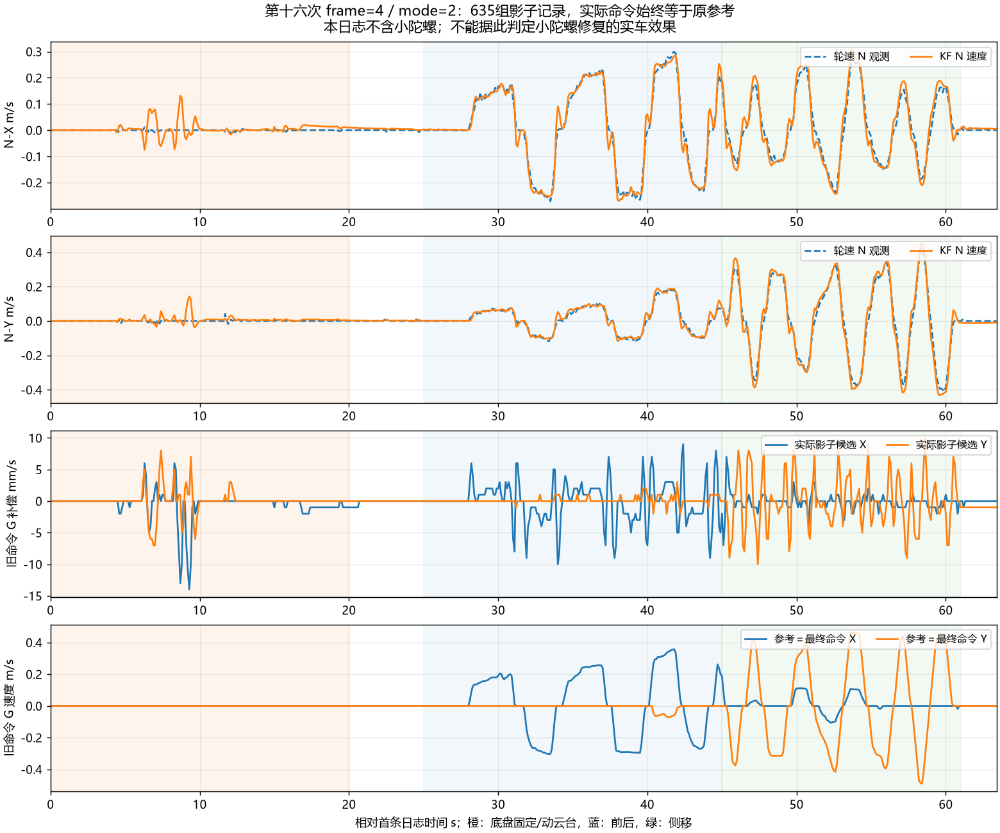

# 第十六次影子日志分析与小陀螺平移修复

原日志：`C:/Users/xuzih/.codex/attachments/03524574-7e8a-48e0-9f48-4772004d0531/Pasted text.txt`。

用户确认这份日志不含小陀螺异常动作；前约 20 秒底盘不动并操作 YAW/PITCH，约 25～44 秒前后移动、45～61 秒侧移，最后停车。以下时间相对首条日志。

## 1. 小陀螺问题定位与修正

**发现并修正了一个能直接造成“推前进却扩大绕圈”的软件错误：输出链把右手姿态相对角，直接用于 Y 轴已反射的旧命令坐标旋转。**本次日志不含该动作，异常依据来自代码推导与独立回归复现；新版实车效果仍须烧录确认。

令 `theta=psi_GN-psi_BN=-offset_angle`，`S=diag(1,-1)`。轮速到固定 N 的已实测链为 `vN=R(psi_BN)*S*v_legacyB`。

frame=3/4 的输出是 `v_legacyB=R(+theta)*u_legacyG`。合并得到：

```
vN = R(psi_BN)*S*R(+theta)*u
   = R(psi_GN-2*theta)*S*u
```

所以云台绝对朝向不变、底盘自旋时，平移方向仍跟着相对角旋转。平均推进被抵消，就会有只能绕圈、增大绕圈范围的感觉。云台中位时 theta 接近零，前后/侧移的原有试验不容易暴露这个问题。之前只验证正反变换互逆和接近中位的实车响应，未验证固定云台朝向下的世界平移方向，这是测试遗漏。

frame=5 改为：

```
输出：v_legacyB = R(-theta)*u_legacyG
因此：vN = R(psi_GN)*S*u_legacyG
返回：hat_legacyG = R(+theta)*S*R(-psi_BN)*vN
                 = S*R(-psi_GN)*vN
```

云台朝向固定时，世界平移方向不再依赖底盘转角。由于入口 theta=-offset_angle，输出也恢复了原框架 `R(offset_angle)` 的方向。

具体修改在 `chassis_motion.c` 的 `WheelRequests()` 和 KF 状态返回 `hat_g` 两处，同步修正正反链，并给出中文注释。轮速的 B 系 Y 反射、固定 N 投影、IMU 尺寸、融合权重、遥控速度上限和小陀螺转速均保留。此次发现不支持继续修改 8.4 cm / 3.7 cm 杆臂尺寸。

## 2. 新增独立回归

`tests/chassis_motion_spin_test.c` 固定云台世界航向，底盘连续转动，摇杆给定恒定二维平移，并独立从四轮参考还原世界平移方向。覆盖正反两个自旋方向、估计/影子/固定主动三模式、多圈旋转及 ±pi 角度跨界；不调用生产正逆解生成期望值。

修正前在 mode=1、底盘角 3 rad 时即失败：实际世界参考约 `(0.2167,-0.0552) m/s`，期望 `(0.1401,0.1743) m/s`。这也说明错误独立于加速度补偿是否追加到电机。修正后世界方向与返回命令速度误差均小于 `1e-4 m/s` 的测试门槛。

原多航向用例同步改为正确物理期望，而不是继续锁定错误旋转方向；生产默认影子、融合/掉线恢复、刚体杆臂、角加速度、轮速限制、急停退出等原有主机回归通过。历史二进制解码回归通过。

## 3. 新日志的实际影子输出

共 635 组完整五行，跨度 63.400 s。本段 seq 连续，无新增丢组；`tdrop=669` 全段不变，表示采集前已累计发送丢组，不能说该计数为零。`qdrop=0`。

全部 `fw=20261030 frame=4 mode=2 valid=1 exit=0 accel=1 obs=15 wheel_mask=15`；全部 `kp_x1000=100 flags=0 sat=0`。635 组均满足两轴 `cmd_g_mmps=ref_g_mmps`，证明影子候选没有追加到实际电机平移参考。

| 阶段 | 时间 | KF−轮速二维差值 RMS | 实际影子候选峰值 |
| --- | --- | ---: | ---: |
| 底盘固定、操作云台 | 0～20 s | 0.0315 m/s | 0.0140 m/s |
| 中间静止 | 20～25 s | 0.0073 m/s | 0.0010 m/s |
| 前后移动 | 25～45 s | 0.0296 m/s | 0.0100 m/s |
| 左右侧移 | 45～61 s | 0.0483 m/s | 0.0102 m/s |
| 最后停车短段 | 61～63.4 s | 0.0134 m/s | 0.0014 m/s |

峰值影子候选出现在约 9.3 秒，约 0.0140 m/s。候选与 `0.1*err_g` 的二维差值最大约 0.00127 m/s，符合整数日志截断和候选斜坡造成的差异量级。此处是实际打印候选，不再是上一轮离线估算。

但操作云台时仍有瞬时融合残差：底盘固定的前段，KF−轮速差值峰值约 **0.143 m/s**；不能据此宣称旋转残差消失或全部工况验收通过。最后停车仅约 2.4 秒，不能拿这一短段判断长期静止漂移。KF 使用轮速观测，两者一致性也不是独立外部测速精度。

移动阶段 theta 接近零（前后约 -0.012～+0.021 rad，侧移约 -0.030～+0.021 rad）；明显非零相对角出现在底盘固定、操作云台阶段。这份日志仍未验证大相对角下的实际平移，更未包含自旋平移。

收到 64 个高频窗口（88～151），累计 good=64090、bad=0，采样间隔 572～1422 μs；`ddrop=67` 全段不变。此段没有新增窗口丢失。



## 4. 交付版本

`MC_FRAME_REVISION=5`，默认仍为 `MC_SHADOW`。加速度融合保持开启，补偿候选继续只计算/记录。修复会改变非零相对角下的平移四轮参考；不能声称所有角度下输出与 frame=4 完全相同。

为下一次直接检查旋转参考与摇杆平移输入，通道 0 文本增加同一状态快照中的两个字段：WHEEL 的 `omega_ref_mradps`、KF 的 `user_g_mmps`。原字段与五行结构保留，状态对象/通信协议布局不变。旋转参考单位为 rad/s×1000，用户平移为 m/s×1000。

ARM 构建通过，text=95984、data=1120、bss=85744 字节。现有裸机系统调用和 RWX 链接告警仍在。生成工程既有 `build/basic_framework_ATYPE.elf/.hex/.bin`，未执行硬件烧录。

ELF SHA256：`166C750B6916F3BAC93EC66F526E63FDB0CC3F6B95B3F0204840E8D257311B74`。

修改前 frame=4 源码与固件保存在 `build/before_20261030_spin_fix/`。

## 5. 下一步只验证小陀螺平移

烧录确认 `fw=20261030 frame=5 mode=2`，继续读取通道 0。云台维持朝向、不拨动 YAW 摇杆：先原地自旋，再给低速前进约 3～5 秒、松开，再做一次侧移；随后退出小陀螺停车，保留约 10 秒日志。正常预期是车身仍自旋，但底盘中心能持续朝云台指定方向移动，不只是扩大绕圈范围。

本次先确认方向修复及实际输出，默认不进入主动补偿。若仍出现异常，可由新字段同时核对用户平移、旋转参考、四轮参考、psi_GN 和 theta，无须再次先采一轮仅静止转云台的长日志。

## 6. 分析产物

- `20261030_第十六次运动日志数据.csv`：635 组原字段及相对时间。
- `20261030_第十六次高频诊断数据.json`：RIGID/AID 原窗口。
- `20261030_第十六次运动日志分析.png`：实际影子候选、融合速度和参考，已检查渲染。
- `build/analyze_motion_sixteenth.py`、`build/motion_text_analysis_16.json`：可复现解析与阶段统计。
