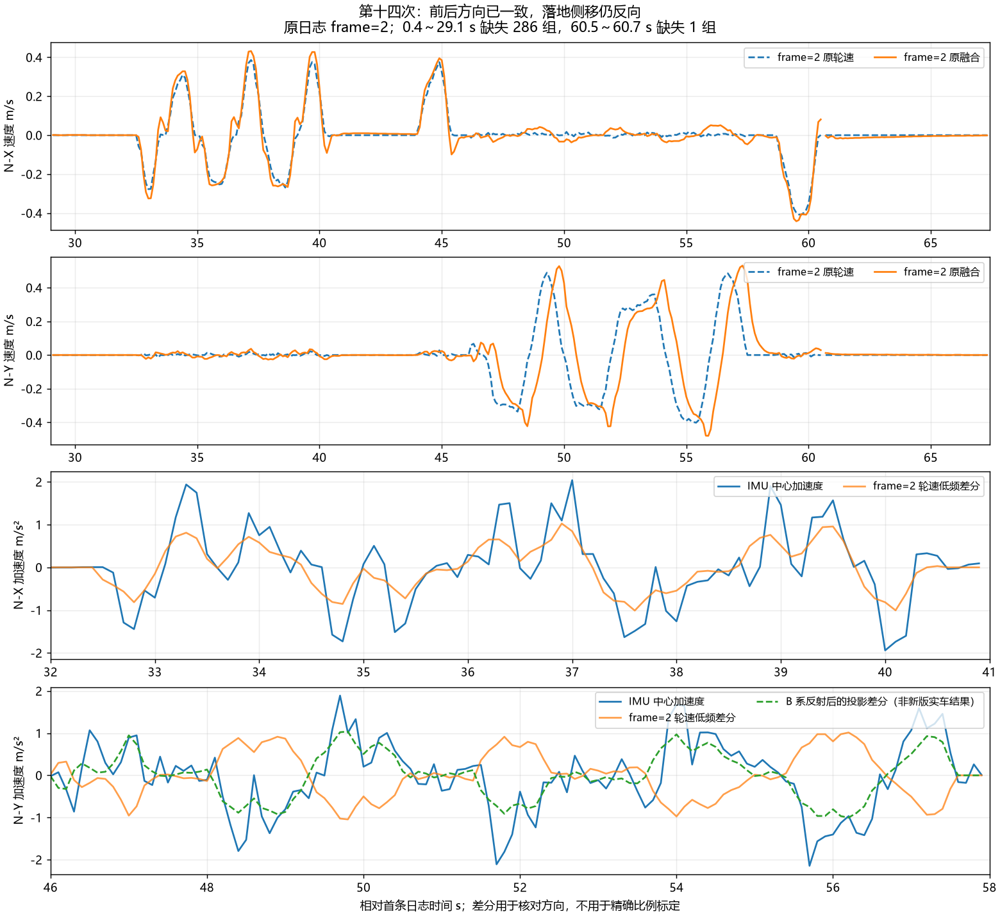

# 第十四次：前后方向修复有效，侧移定位旧轮速代数 Y 反向

原始文件：`C:/Users/xuzih/.codex/attachments/9292540b-7ef9-4ba3-947a-01bbce89b7f2/Pasted text.txt`。

用户确认：全程落地，约 32～45 s 前后移动、46～58 s 左右侧移、最后再前后移动停车，侧移没有打滑、碰撞。时间均相对首条日志，而非上电时刻。

本次实测固件为 `fw=20261030 frame=2 mode=1`。**加速度已进入 KF，不是“还没开融合”**；此次发现的是轮速与 IMU 坐标接入问题。代码已修正并构建为 `frame=3`，本文将原版实测和修正后的软件验证分开记录。

## 1. 记录完整性与估计状态

- 共 387 组完整五行，首末跨度 67.3 s。0.4～29.100016 s 缺失 286 组，60.500012～60.7 s 缺失 1 组；累计 `tdrop=287 qdrop=0` 与序号相符，不能推断缺失段始终静止。
- 全部记录 `accel=1 wheel_mask=15 obs=15 corr=1`；386 组 `valid=1`，首组仍处恢复阶段 `valid=0 exit=8`。
- `exit=0` 共 376 组；约 64.9～65.8 s 的 10 组 `exit=1` 仍 `valid=1`，是输出关闭，不是滤波数值崩溃。
- 已收到秒级诊断窗 30～67，共 38 个；38054 个有效 INS 样本、0 个拒绝样本，读取间隔 569～1412 μs。`ddrop=29`，未收到的窗不参与统计。
- 首 0.4 s 有明显 PITCH 启动运动，首组角速度 Y 约 4.16 rad/s，不能当静止噪声使用。可见的 29.1～32 s 静止段融合速度模长 RMS 约 0.00059 m/s，最后 66～67.3 s 约 0.00239 m/s。
- `mode=1` 且所有 `dv_g=0`：外层补偿没有进入四轮输出。

## 2. 定位证据

| 区间 | IMU 加速度与同轴轮速低频差分相关系数 | 融合速度减轮速的向量 RMS | 同一差值峰值 |
| --- | ---: | ---: | ---: |
| 32～41 s 前后 | +0.847 | 0.0475 m/s | 0.0993 m/s |
| 46～58 s 侧移 | **−0.875** | **0.2586 m/s** | **0.4816 m/s** |

相关系数按连续片段求差分，去掉每段首末各三点，不跨丢失段插值。它用于验证方向，不能拿 10 Hz 抽样导数当精确加速度/轮径标定。

独立积分也支持同一结论。轮速变化和中心加速度积分单位均为 m/s：

| 原日志 seq 区间 | 原轮速 Δv_N | IMU ∫a_N dt | 方向 |
| --- | --- | --- | --- |
| 6480～6560 前后 | (−0.083, 0.000) | (−0.0755, −0.0200) | 同向 |
| 6640～6720 前后 | (+0.280, −0.004) | (+0.5052, −0.0260) | 同向 |
| 9380～9440 侧移 | (+0.007, −0.231) | (−0.0569, +0.1691) | 反向 |
| 10840～10940 侧移 | (−0.002, −0.332) | (−0.0602, +0.4403) | 反向 |
| 11240～11340 侧移 | (+0.011, +0.371) | (+0.0246, −0.5334) | 反向 |

实际检查了 2 个前后和 6 个侧移区间，全部前后同向、侧移反向。此前仅使用 J 的正逆解自洽测试，漏掉了旧轮代数与姿态坐标之间的反射；第十三次只有前后动作，也不足以核验横向。

**当前有明确证据的问题是软件坐标接入，不支持继续靠修改 8.4 cm/3.7 cm 安装尺寸来消除该符号冲突。** 杆臂误差会影响旋转时的残差，不能解释前后正常而侧移连续多次反向；安装尺寸本次保留。加速度幅值和轮速导数仍有差异，尚不能据此保证速度绝对精度或任意云台角度下的实车表现。

## 3. frame=3 的代码修正

修改仅落在 `chassis_motion.c/.h` 的坐标边界、配置版本与说明，以及对应回归测试：

1. 保留原 `MC_J_ROWS` 及遥控到四轮的输出公式。J 逆解得到旧代数向量后，先映射为右手姿态 B 的 `(vx,-vy)`，再按底盘航向投影到固定 N。
2. 估计返回旧命令坐标时执行 `R(-theta_BG) * S * R(-psi_BN)`，`S=diag(1,-1)`。这与原电机链 `J * R(theta_BG)` 互逆，避免日后开启补偿时因比较坐标不同而反向追加。
3. 反射放在 B 系，不直接翻 N.y 或最终 G.y；旋转与反射不交换，有云台相对角时尤其如此。
4. `wheel_b/wheel_n/x` 是姿态 B/N，`hat_g/ref_g/error_g/dv_g/cmd_g` 是旧命令坐标，已加中文注释。
5. `MC_FRAME_REVISION=3`；保留 `MC_IMU_ACCEL_VALIDATED=1`、默认 `MC_ESTIMATE_ONLY`、1.0 m/s 速度上限和原 RTT 通道 0 文本。

离线按同一 B 系映射重新投影原轮速，侧向相关由 −0.875 变为 +0.875，八段积分的方向内积全部转为正。**这是投影核对，不是烧录新版后的实车结果，也没有把原 frame=2 KF 输出改写成 frame=3 输出。**

## 4. 软件验证与构建

- 新测试直接使用上述原始四轮反馈、航向和加速度积分作为独立证据。用备份的 frame=2 代码运行，首次侧移 `seq=9380..9440` 失败，方向内积 −0.03943；frame=3 的八段全部通过。
- 独立传感器/轮代数轨迹覆盖四个航向、四个非零/零云台相对角，真实生产 KF 的平移速度最大误差约 0.000083 m/s；原有四轮命令保持一致。
- 主动补偿稳态测试在各航向/相对角确认 `ref=hat` 时补偿归零、四轮输出符合原公式。测试从正弦轨迹跳到常速，先等待 4.5 s 让 KF 收敛，再断言稳态，避免把过渡误当坐标错误。
- 通用 KF/独立 Joseph 参考、缺测/回绕/退出/限幅、平面及三维杆臂、采样差分、生产融合、实际 INS/EKF 链、诊断格式/丢包与旧二进制布局检查均通过。
- ARM Makefile 构建成功：text 95892、data 1120、bss 85744 字节。链接器仍报告裸机 `_close/_lseek/_read/_write` 桩和 RWX 段告警。

当前烧录产物为 `build/basic_framework_ATYPE.elf/.hex/.bin`。ELF SHA256：

`EC5E88F7D5E3E7BDFC10EC512A5E3A9D81EAD4787D03EDBECE1CD54426E0E4E5`

修改前源文件及固件备份在 `build/before_20261030_frame3/`。复现分析使用 `build/analyze_motion_fourteenth.py`；原数据 CSV、秒级诊断 JSON、曲线保存在本目录，统计摘要在 `build/motion_text_analysis_14.json`。

## 5. 下一次只做短时两轴确认

烧录后先确认 `fw=20261030 frame=3`。云台保持中位、底盘落地，用原速度上限内的小摇杆量采集约 30 s：静止 5 s → 前后移动并停车约 10 s → 左右侧移并停车约 10 s → 静止 5 s，原通道 0 保存。

这一步只确认修改后的两轴方向和融合速度响应，不要求再重复长时间静止或整套 YAW/PITCH 测试。通过后再补短段有云台相对角的平移核验，并评估影子补偿；当前构建没有直接跳到主动补偿。
