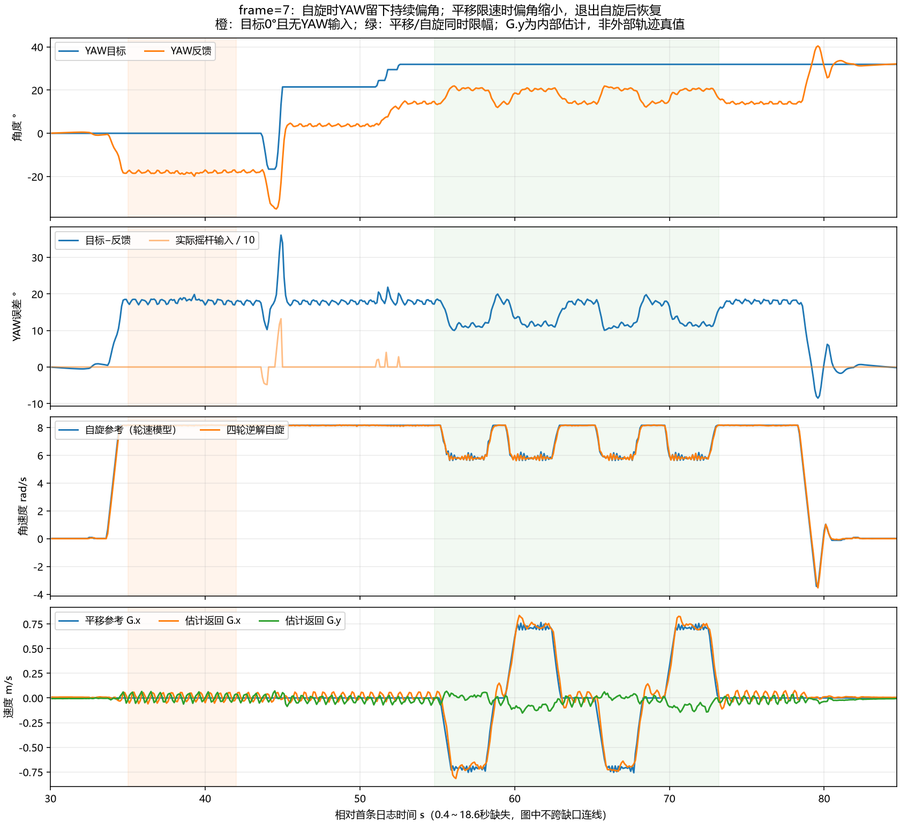

# 第十九次：自旋YAW持续偏角与前后斜行

原日志：`C:/Users/xuzih/.codex/attachments/462d147a-456d-4a9f-b9b8-a22704976cce/Pasted text.txt`。

用户描述启动后云台偏转且停在新朝向；平移斜行，前后不能准确回到原点。本次记录为`fw=20261031 frame=7 mode=3`，确实包含完整可见的自旋启动、两次前后动作及退出自旋。下文时间均相对首条日志。

## 实测结论

**自旋时YAW目标与反馈之间确实留下约18°持续误差。控制器看到了误差，不能再只用启动反作用或IMU安装位置来解释。代码中速度环积分额度3000过小，是最符合本次现象的控制机制；本日志未直接记录Iout，尚不能声称已实测其饱和。**

| 可见阶段 | 时间/s | YAW目标/° | 平均目标−反馈/° | 轮速模型自旋参考/rad/s |
| --- | ---: | ---: | ---: | ---: |
| 自旋前 | 30～33.5 | 0 | 约0 | 约0 |
| 第一次纯自旋 | 35～42 | 0 | 18.047，标准差0.579 | 8.162 |
| 操作YAW后再次纯自旋 | 46.5～50 | 21.454 | 17.754 | 8.162 |
| 负向平移 | 56.1～57.8 | 31.914 | 11.292 | 5.815 |
| 正向平移 | 60.2～61.9 | 31.914 | 11.775 | 5.854 |
| 最后纯自旋 | 74～78 | 31.914 | 17.943 | 8.162 |
| 退出自旋后 | 83～84.7 | 31.914 | 0.097 | 0.017 |

33.7～34.5s自旋参考从0.667升到8.162rad/s，反馈从约−0.46°变到−13.24°；34.8s后在约−18°附近保持。35～42s内`used=0`且目标始终0°，所以这段偏角不由摇杆目标变化造成。43～53s确实存在短时YAW输入，不能将后段目标变化当成自动漂移；不过输入松开后仍保留约18°误差，同样支持与持续自旋负载有关。

退出自旋后反馈回到目标附近，不符合“IMU永久换了零点”这一单独解释。不能仅凭内部IMU反馈证明外部绝对航向始终准确，但本次不需要继续靠调整8.4cm/3.7cm杆臂来解释18°位置误差。

## 积分限幅为何会留下固定偏角

生产代码为位置P环`Kp=8`串联速度PI环`Kp=50、Ki=200`，速度积分输出限额3000，总输出上限20000。

持续自旋时，保持云台世界朝向需要GM6020持续相对底盘反转。驱动需要的持续指令包含相对转动的负载及反电动势影响，不能只按云台世界角速度为零就认为输出需求为零。

如果维持姿态需要的输出超过积分可承担的3000，位置误差就会通过比例链提供剩余输出。18°误差对应约`18×8×50=7200 raw`比例项；若积分已到3000，总需求约10200raw。平移时转速下降、误差缩小，退出自旋后误差消失，都与该机制一致。这是依据观察建立的解释，不是独立测出的电机负载。

本次将YAW速度积分限额提高为**12000**，保留原Kp/Ki和总输出上限20000。`GM6020`的这些raw是驱动指令量，不能直接换算为安培或力矩。没有为了抵消固定偏角而添加新的YAW目标偏置。

## 斜行的证据与方向读取修复

原公共云台反馈将浮点单圈角存入`uint16_t`，丢失小数；`RobotCMDTask`在`GimbalTask`之前运行，因此命令还使用上一机器人周期的反馈。frame=7的8.162rad/s下，仅5ms就对应2.34°，不包括额外CAN采样与执行延迟。

frame=8增加`GimbalGetYawFeedback()`原子快照接口，CMD方向转换读取最新完整精度CAN角，公共通信结构保持原布局。样本离线或超过20ms时沿用原反馈，不外推失效样本。本次消除了整度截断和固定的一周期消息滞后，并没有声称补偿了所有电机动态延迟。

56.1～57.8s负向平移时，平均参考G约`(-0.712,-0.014)m/s`、估计返回约`(-0.704,+0.011)m/s`；60.2～61.9s正向时，参考约`(+0.716,0)m/s`、估计返回约`(+0.744,-0.100)m/s`。重复两次的正向G.y也约−0.098m/s，表明前后侧向残差不对称。这里是内部速度估计，不能当作外部轨迹真值或回程位置误差的精确测量。

平移时自旋参考降至约5.6～6.2rad/s，同时出现`flags=1/5`和36000°/s的轮速参考，说明统一轮速限幅确实触发。限幅本身保持理想瞬时方向，但会改变速度及负载，从而改变云台偏角、角度延迟误差与实际轮速跟踪。当前为速度补偿，没有位置回原点闭环，手动前后不能保证精确返回原点。

## 额外发现：旋转比例仍需区分

35～42s完整精度编码器解缠后的相对转速约**583.94°/s**，同期四轮逆解约**467.21°/s**，相差约25%。此时云台IMU平均gz接近零，但有周期波动。编码器相对角不是独立底盘绝对航向传感器，该差异提示有效旋转几何、轮地滑移及同步问题仍需核对；不能直接认为轮速模型给出的78rpm就是实车绝对转速。

本次没有仅凭这一段改动机械半径、J旋转列或IMU杆臂，以免把不同来源的误差相互掩盖。

## frame=8新增诊断与验证

通道0保持文本；`[YAW] diag=3`追加以下字段：

| 字段 | 含义 |
| --- | --- |
| `ctrl_t_us` | 此次控制器诊断读取时间；独立于运动采样和命令帧时间 |
| `spd_p_raw` | YAW速度PID比例输出 |
| `spd_i_raw` | YAW速度PID积分输出 |
| `out_raw` | YAW电机限幅前请求 |
| `sent_raw` | 已装入CAN发送缓冲的指令镜像，非实际ACK/电流 |
| `i_limit_raw` | 本版YAW积分限额12000 |

新增回归直接链接现有`controller.c`，使用双方向、7600/10200raw持续负载、0.03/0.09s时间常数的一阶模型：旧限额保留约11.5°/18°误差，新限额下稳态误差均小于0.1°；撤去扰动后恢复，积分和总输出均受限。这验证积分额度机制，不是实测GM6020模型，更不是实车调参完成证明。

已有自旋方向回归扩展到±2rad/s和当前±8.162rad/s目标、三种估计/补偿模式及多次角度跨界。完整主机回归、历史二进制解码回归通过。ARM构建成功，text=96344、data=1120、bss=85776字节；保留原未使用MouseKeySet、裸机系统调用及RWX链接告警。

烧录产物：`build/basic_framework_ATYPE.elf/.hex/.bin`；本次未执行硬件烧录。ELF SHA256：`0B24CC36C9D35FBDD27943D23D35339A194707C2CA03362E31A743D4D6242F3E`。

原frame=7源码和固件备份在`build/before_20261031_yaw_spin_fix/`。

烧录后检查`fw=20261031 frame=8 mode=3`及`diag=3 i_limit_raw=12000`。按“静止→纯自旋数秒→前进→后退→退出自旋”做短测，重点观察松手后目标不变时误差是否恢复到约1～2°以内、积分是否承担持续输出、是否还有停在约18°的偏差。初始扰动仍可能存在，本次不保证启动瞬间零偏转或回程精确重合。如果仍有持续偏差，可以用新增实际Iout/Pout/输出直接区分积分额度、总输出及反馈问题。

## 日志完整性

667组完整五行，跨度84.700s；0.4～18.600s缺181组，与`tdrop=181`一致；自旋启动33.7s及后续动作连续可见。前5组四轮离线且输出禁止，其余662组`valid=1 exit=0 obs=15`；全程`accel=1`，无底盘电流发送饱和标记，主动补偿向量峰值约0.0191m/s。`sat=0`只说明底盘电流限幅标记，不说明YAW积分没有饱和。`trim_updates=0`，本次没有实际发生静止零偏学习。

解析脚本`build/analyze_motion_nineteenth.py`，原始展开CSV为同目录`20261031_第十九次小陀螺日志数据.csv`；机器可读结果`build/motion_text_analysis_19.json`。
