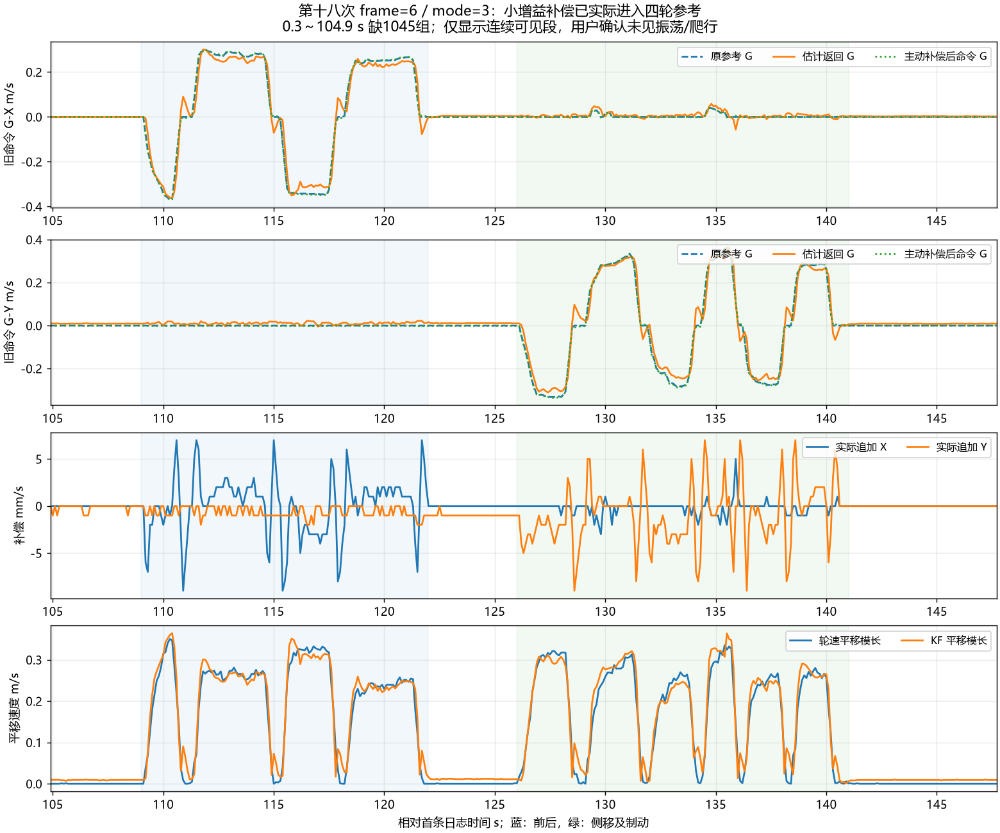

# 第十八次：固定小增益主动补偿基础试运行正常

原日志：`C:/Users/xuzih/.codex/attachments/1a5fbac9-ef08-4164-b637-01790f666f90/Pasted text.txt`。

用户确认动作顺序为先前后移动、再左右侧移、最后停车，未观察到振荡、持续爬行或明显操控异常。

**frame=6 / mode=3 的主动补偿已实际进入四轮速度参考，可见低速前后、侧移及停车的基础试运行表现正常。继续保留固定 Kp=0.1 与现有固件，不因这一组数据加大增益。**这不是高速、主动补偿下小陀螺全工况或性能提升幅度的验收。

## 1. 补偿确实作用于输出

433 组记录全部为 `fw=20261030 frame=6 mode=3`。其中 308 组的整数 `cmd_g_mmps` 与 `ref_g_mmps` 不同，289 组的 `dv_g_mmps` 打印为非零；三个字段分别截断为整数，因此这两个计数不必相同。

每组均满足 `cmd_g=ref_g+dv_g`，逐轴文本差值最多 1 mm/s，符合独立整数截断。可见补偿向量峰值约 **0.00906 m/s**，未触及 0.10 m/s 补偿上限。

另从四轮 `req_dps` 独立消去旋转共同项，还原旧 B 平移，再按相对角转回旧命令 G，与实际命令比较：二维差值最大约 **0.00147 m/s**。与“原参考＋打印补偿”的差值最大约 0.00205 m/s，符合速度/角度/转速多次截断造成的误差范围。这验证了补偿进入四轮速度参考，而不只是日志状态字段改变。

四轮参考峰值 5061 °/s，发送电流镜像峰值 2244 raw；全部 `flags=0 sat=0`。此处是软件参考和电流发送镜像，不代表独立测得的轮端力或实际 CAN ACK。

## 2. 连续可见段指标

时间相对首条日志。前后阶段取 109～122 s，侧移及刹停取 126～141 s。KF 使用轮速观测，二者一致性不是独立外部测速精度。

| 阶段 | 时间 | KF−轮速二维差值 RMS | 差值峰值 | 主动补偿峰值 |
| --- | --- | ---: | ---: | ---: |
| 动作前可见静止 | 105～109 s | 0.0091 m/s | 0.0102 m/s | 0.0010 m/s |
| 前后移动/启停 | 109～122 s | 0.0335 m/s | 0.1173 m/s | 0.0091 m/s |
| 中间停车 | 123～126 s | 0.0115 m/s | 0.0122 m/s | 0.0010 m/s |
| 侧移/启停 | 126～141 s | 0.0353 m/s | 0.1205 m/s | 0.0091 m/s |
| 最后稳定停车 | 142～147.7 s | 0.0091 m/s | 0.0100 m/s | 整数打印为 0 |

最后稳定停车段的轮速逆解平移 RMS 约 **0.00013 m/s**，接近日志量化下限，结合用户观察未见持续爬行。KF 仍有约 0.009 m/s 的估计残差，不能把“打印补偿为零”解释为估计或真实补偿严格为零。Kp=0.1 对应的静止补偿约为亚毫米/秒量级，可能被整数文本截断隐藏；本次未观察到它造成持续移动。

轮速在停止后迅速回落，估计有短暂尾部。可见记录与用户反馈未显示持续失控振荡；10 Hz 日志不能排除未记录的高频抖动，也不能据此量化性能优于影子版本多少。

本次云台航向约 1.34 rad（约 77°），前后与侧移不再分别直接对应固定 N 的 X/Y。将轮速差分和中心加速度投影到当时云台命令方向后，前后相关系数为 **+0.774**，侧移为 **+0.809**，方向一致。仅用于方向核对，不用 10 Hz 差分做精确比例标定。

## 3. 状态与记录缺口

- 共 433 组完整五行，跨度 147.700 s。
- 首组 `valid=0 exit=8` 为恢复尚未完成；其余 432 组全部 `valid=1 exit=0 kp_x1000=100`。
- 全部 `accel=1 obs=15 wheel_mask=15 corr=1`，没有记录到融合关闭、数值退出或观测失效。
- `qdrop=0`。0.300～104.900 s 缺失 1045 组，与 `tdrop` 从 0 增至 1045 一致；缺口之后 seq 连续。
- 43 个高频统计窗口连续覆盖窗口号 105～147：good=43064、bad=0，采样间隔 576～1421 μs；`ddrop=104` 在可见段保持不变。
- 首条已经有四轮同向旋转，不能把最初 0.3 s 当作静止基线。启动标定温度约 32.1°C，末段温度约 40°C，不能当作严格恒温对照。

早期记录缺失约 104.6 s，所以“正常”的判断限于记录到的状态、连续运动段和用户观察；不能声称完整 147.7 s 均有证据。发送丢组不是 IMU/控制停摆的直接证据。

## 4. 当前状态与后续使用

轮速＋加速度估计融合已经开启，固定小增益补偿也已经开启并在本次落地动作中运行。当前没有从本日志发现需要再次修改坐标、杆臂或控制参数的问题，继续使用 **frame=6 / mode=3 / Kp=0.1**。

这一阶段的目标是检查方向、输出接入和基础运行表现，现有证据支持通过。此前 frame=5 的小陀螺方向修复已有用户单独测试反馈，但本次未记录 mode=3 下持续小陀螺；不要将两者合并成主动补偿全工况通过。

后续若要衡量补偿带来多少收益，应在相同地面、速度、动作波形及温度条件下做补偿开/关对照，比较稳定段速度误差、启停响应与停车表现。不同手动轨迹的日志不能直接用于证明提升比例。当前保留 Kp=0.1，转速调度模式仍未默认启用，无需再重复前置静止标定来证明“已经开启”。

RTT 应先保持连续接收再开始关键动作，避免大段缺失；传输继续非阻塞，不以拖慢控制任务补日志。

## 5. 产物和验证范围

本轮只新增分析脚本、数据、图和文档；固件源码/默认参数保持 frame=6。实际运行分析脚本，完整组、缺口核账、主动命令求和、独立四轮参考核对等断言通过；曲线已渲染并检查。没有因分析文档变化重复编译或烧录固件。

- `20261031_第十八次运动日志数据.csv`：433 组原字段、相对时间。
- `20261031_第十八次高频诊断数据.json`：43 个 RIGID/AID 窗口。
- `20261031_第十八次运动日志分析.png`：原参考、估计返回、实际追加量与停车曲线。
- `build/analyze_motion_eighteenth.py`、`build/motion_text_analysis_18.json`：可复现原附件解析和指标。
